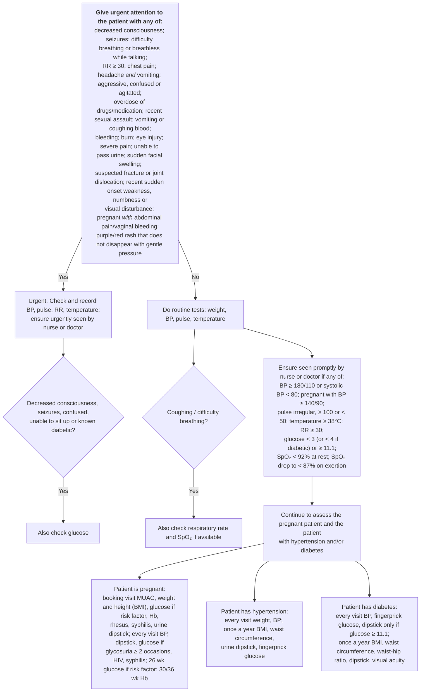

# Page 11 – Initial assessment of the patient: flowchart

Source: `inputs/2026/p11.png` (APC 2026 e-book, page 11). The page is a top-to-bottom sequence of
boxes joined by connectors, ending in three parallel branches (pregnant / hypertension / diabetes).

## Decision nodes → rules

| Node | Modelled as | Rule |
|---|---|---|
| Red box (any of the 20 items) | Asked of every patient with any recorded clinical finding; any one item → Urgent | `Check for urgent signs at initial assessment of the patient` → `Urgent: initial assessment danger signs` |
| Headache *and* vomiting | `(and Headache Finding of vomiting)`; neither alone | `Urgent: initial assessment danger signs` |
| Pregnant *with* abdominal pain/vaginal bleeding | `(and Pregnancy (or Abdominal pain, Bleeding from vagina))` | `Urgent: initial assessment danger signs` |
| GLU = Yes | `measure` blood glucose due to decreased consciousness, seizure, clouded consciousness (confused), unable to sit up or `(active_condition Diabetes mellitus)` | `Initial assessment: measure glucose if decreased consciousness, seizures, confused, unable to sit up or diabetic` |
| ROUT (weight, BP, pulse, temperature) | Routine vitals: no task needed | — |
| COUGH = Yes | `measure` respiratory rate and SpO₂ due to cough or difficulty breathing | `Initial assessment: measure respiratory rate and oxygen saturation if coughing or difficulty breathing` |
| PROMPT ("seen promptly") | **Not modelled**: VHA's lowest priority is `Urgent`, which the page reserves for the red box (see remaining questions) | — |
| PREG | `measure` MUAC and height, due to `(active_condition Pregnancy)` | `Initial assessment: measure MUAC and height in the pregnant patient` |
| HTN | `measure` height, waist circumference, glucose, due to `(active_condition Hypertensive disorder, systemic arterial)` | `Initial assessment: measure BMI inputs, waist circumference and glucose in the patient with hypertension` |
| DM | `measure` glucose, height, waist and hip circumference, due to `(active_condition Diabetes mellitus)` | `Initial assessment: measure glucose, BMI inputs, waist and hip circumference in the patient with diabetes` |

## Notes

- Visit timing ("at booking visit", "every visit", "once a year", "3-6 monthly", "at 26 / 30 / 36
  weeks") cannot be expressed; each measure task fires whenever its condition is active.
- Hb, urine dipstick, rapid rhesus, syphilis, HIV tests and visual acuity have no observable/unit
  in the language and are not modelled.
