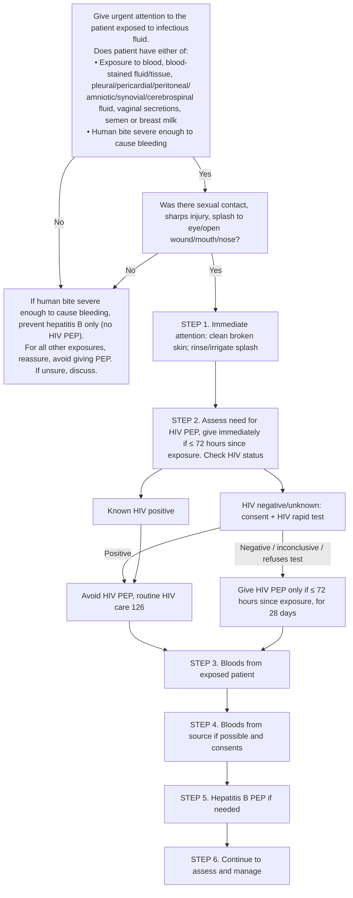

# Page 122 – HIV: post-exposure prophylaxis (PEP): flowchart

Source: `inputs/2026/p122.png` (the whole algorithm sits inside the red box).

## Decision nodes → rules

| Node | Modelled as | Rule |
|---|---|---|
| Presenting complaint "patient exposed to infectious fluid" | Exposure to body fluid (any descendant substance) or a human bite wound | Trigger of `Check for HIV PEP infectious fluid exposure`; first `and` arm of `Urgent: exposure to infectious fluid (HIV PEP)` |
| "Does patient have either of" = Yes | Exposure to any of the 10 listed fluids, **or** human bite wound **and** bleeding | `Urgent: exposure to infectious fluid (HIV PEP)` (Urgent) |
| Sexual contact / sharps injury / splash? | Not modelled: decides HIV PEP (management) only | — |
| HIV status, rapid test result, ≤ 72 hours | Not modelled: PEP management | — |
| Steps 3–6 | Laboratory tests and medicines: management | — |

## Notes

- The page's "Yes"/"No" branches after the first question decide whether HIV and/or hepatitis B PEP
  is given. That is management and is out of scope for this pass; the triage logic is the header plus
  the "either of" list.
