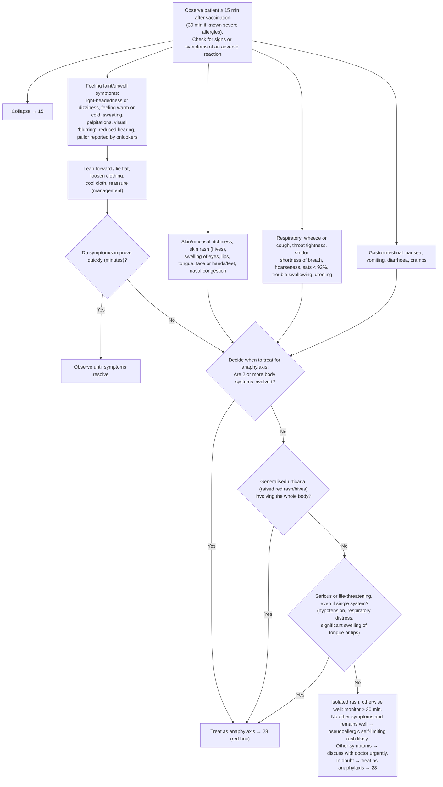

# Page 14 – Observation post vaccination: flowchart

Source: `inputs/2026/p14.png` (APC 2026, page 14). The only red box is the pointer
"Treat as anaphylaxis → 28"; the decision logic that leads to it sits outside the red box.

## Decision nodes → rules

| Node | Modelled as | Rule |
|---|---|---|
| START (check for adverse reaction) | `Vaccination given` (situation) triggers a `check_for` of every listed sign and symptom, plus "Generally unwell" for "otherwise well" | `Check for adverse reaction after vaccination` |
| Collapse → 15 | Cross-reference only; page 15 handles collapse | not encoded |
| IMP (improve quickly?) | **Not modelled**: the language cannot express "improved within minutes". Faint/unwell symptoms count as a body system in D1 whether or not they improved | — |
| D1 = Yes | `any2` of the four groups (faint/unwell, skin/mucosal, respiratory, GI), each group an `or` so it counts once | `Diagnose probable anaphylaxis after vaccination`, `any2` branch |
| D2 = Yes | `Urticaria` with qualifier `Generalized` | same rule, second branch |
| D3 = Yes | `Low blood pressure`, `Respiratory distress`, `Swelling` of tongue or lip with `Severe (severity modifier)` | same rule, remaining branches |
| TREAT | `probable` Anaphylaxis; urgency and treatment are on page 28 (pointer-only red box) | no priority evaluation on this page |
| ISO | Vaccination given, urticaria, and recorded absence (`no`) of every other checked sign including generalised urticaria and "generally unwell" | `Diagnose probable pseudoallergic rash after vaccination` |
| "If in doubt, treat as anaphylaxis" | Not representable (clinical judgment) | — |
