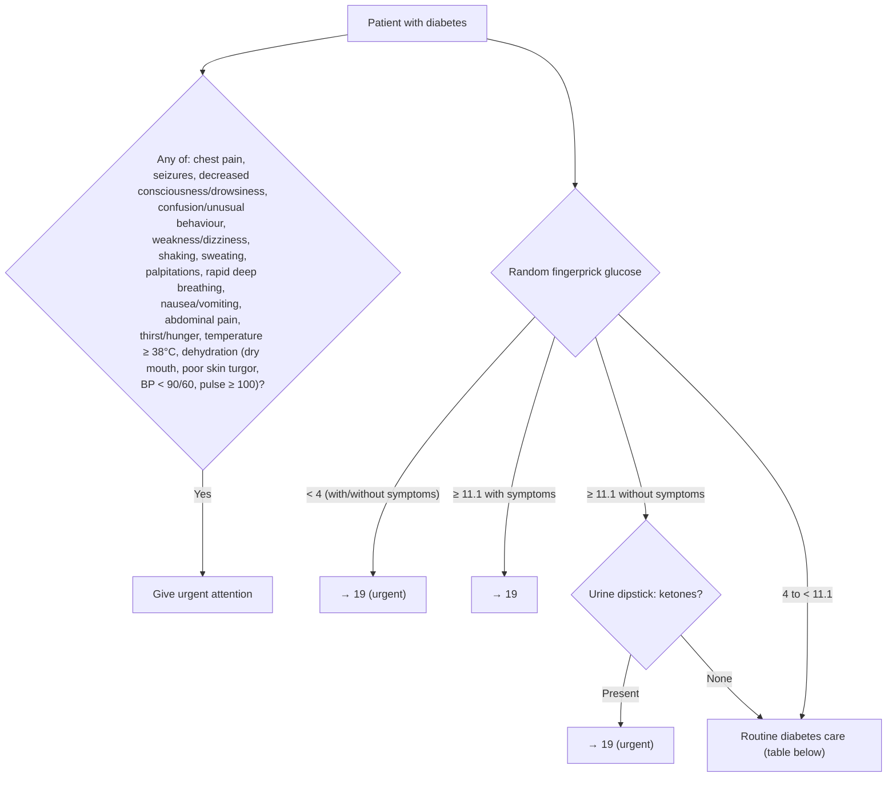

# Page 145 – Diabetes: routine care: flowchart

Source: APC 2026 page 145 (red box). The red box has a short glucose algorithm; the rest of the
page is a routine-care table.

## Decision nodes → rules

| Node | Modelled as | Rule |
|---|---|---|
| Red-box symptom list | Diabetes **and** `or` of every listed finding/measurement | `Check for urgent signs in the patient with diabetes`; `Urgent: diabetes with danger signs or abnormal glucose` |
| Glucose < 4 | Diabetes **and** Blood glucose status < 4 mmol/L | `Urgent: diabetes with danger signs or abnormal glucose` |
| Glucose ≥ 11.1 with symptoms | Not separately encoded: the symptoms already make the patient Urgent | (covered by the symptom branch) |
| Glucose ≥ 11.1 → ketones? | Diabetes **and** glucose ≥ 11.1 triggers a ketone check | `Check urine dipstick for ketones: diabetes with glucose >= 11.1` |
| Ketones present | glucose ≥ 11.1 **and** Ketonuria | `Urgent: diabetes with danger signs or abnormal glucose` |
| Routine care: weight, BMI, WC | Measure task for the patient with diabetes | `Measure weight, BMI and waist circumference in diabetes routine care` |
