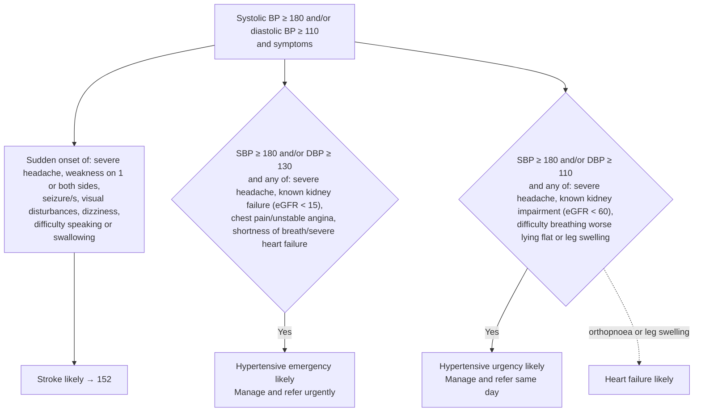
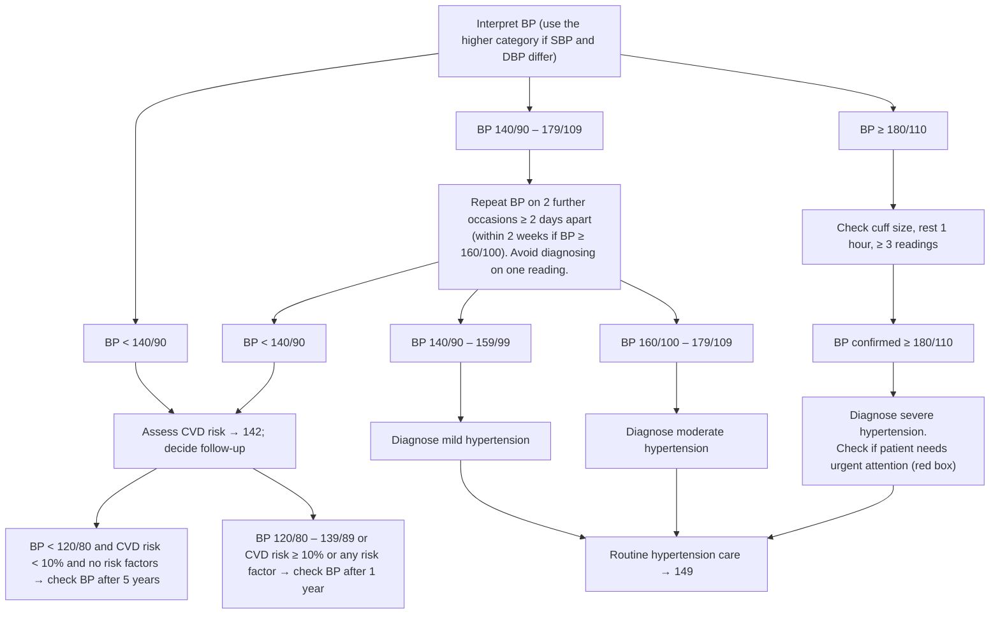

# Page 148 – Hypertension: diagnosis: flowchart

Source: `inputs/2026/p148.png` (APC 2026 e-book). The red box (urgent attention) and the lower
"Approach to interpreting a BP in a patient not needing urgent attention" chart.

## Red box: urgent attention

## Lower chart: patient not needing urgent attention (not encoded, see remaining questions)

## Decision nodes → rules

| Node | Modelled as | Rule |
|---|---|---|
| Red box header: SBP ≥ 180 and/or DBP ≥ 110 | `(or (>= SBP 180) (>= DBP 110))` | trigger of `Check for urgent severely raised BP conditions`; first `and` arm of `Urgent: severely raised BP with symptoms` |
| Sudden-onset symptoms → stroke likely | BP ≥ 180/110 **and** any of seven findings with the `Sudden onset` qualifier (severe headache also `Severe`) | `Diagnose probable stroke with severely raised BP` |
| Hypertensive emergency likely | (SBP ≥ 180 or DBP ≥ 130) **and** any of: severe headache, known renal failure, chest pain, preinfarction syndrome (unstable angina), dyspnoea, severe heart failure | `Diagnose probable hypertensive emergency` |
| Hypertensive urgency likely | (SBP ≥ 180 or DBP ≥ 110) **and** any of: severe headache, known renal impairment, orthopnoea, leg swelling | `Diagnose probable hypertensive urgency` |
| Heart failure likely | BP ≥ 180/110 **and** (orthopnoea or leg swelling) | `Diagnose probable heart failure with severely raised BP` |
| Give urgent attention | BP ≥ 180/110 **and** any of the three likely diagnoses above (active_condition) | `Urgent: severely raised BP with symptoms` |
| Manage and refer urgently / same day | management | not encoded (no `manage` tasks) |
| Lower chart: mild / moderate / severe hypertension | needs averaged readings on separate occasions | not encoded |

## Notes

- "and/or" is read as `or`.
- eGFR thresholds (< 15, < 60) cannot be expressed (no lab observable); the known-condition findings
  are used without them.
