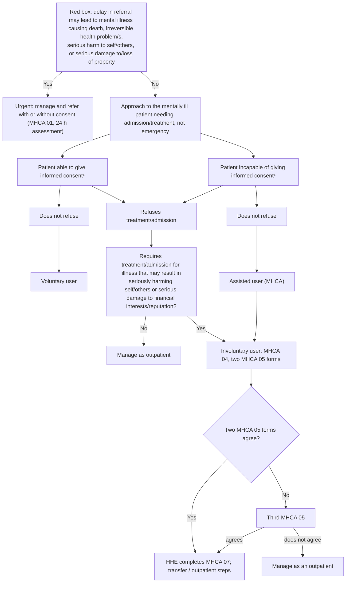

# Page 158 – The mentally ill patient needing treatment or admission: flowchart

Source: `inputs/2026/p158.png`. The red box is triage; the flowchart below it is a legal (Mental Health Care Act) routing algorithm for patients **not** needing emergency referral.

## Decision nodes → rules

| Node | Modelled as | Rule |
|---|---|---|
| Red box | Mental disorder **and** any of: increased risk of self-injurious behaviour, high risk of harm to others, increased risk of destructive behaviour to property | `Check for urgent risks in the mentally ill patient needing treatment or admission`; `Urgent: mentally ill patient at risk of serious harm or property damage` |
| Red box: death, irreversible health problem/s | Not modelled (no SNOMED concept) | – |
| Consent / refusal / MHCA user type / forms | Legal and management routing, not triage or diagnosis | Not modelled |
