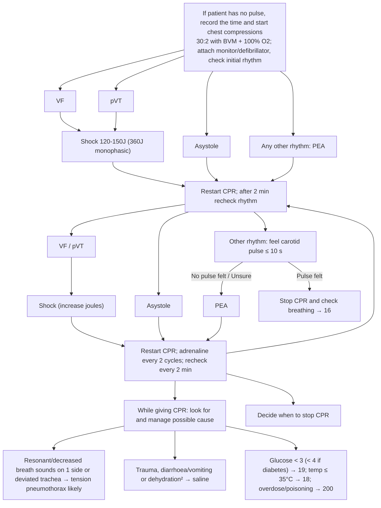

# Page 17 – Cardiopulmonary resuscitation (CPR): flowchart

Source: `inputs/2026/p17.png` (red box 1). The algorithm is almost entirely management (shocks,
drugs, compressions); only the entry condition and the "look for possible cause" lines carry triage
or diagnostic logic.

² Thirst, dry mouth, poor skin turgor, BP < 90/60, dehydration likely.

## Decision nodes → rules

| Node | Modelled as | Rule |
|---|---|---|
| No pulse (entry) | Cardiac arrest warning sign or Absent pulse | `Emergency: no pulse, start CPR`; trigger of `Check for reversible causes during CPR` |
| Tension pneumothorax likely | Arrest context **and** any of unilateral hyperresonance, unilateral decreased breath sounds, displaced trachea | `Diagnose probable tension pneumothorax during CPR` |
| Dehydration² (footnote) | Arrest context **and** any of increased thirst, xerostomia, decreased skin turgor, SBP < 90, DBP < 60 | `Diagnose probable dehydration as a cause of cardiac arrest` |
| Rhythm branches (VF, pVT, asystole, PEA, pulse felt/unsure) | Not modelled: they route to management (shock / no shock / stop CPR) | — |
| Glucose, temperature, overdose/poisoning | Not modelled: pointers to pages 19, 18, 200 | — |
| Decide when to stop CPR | Not modelled: management | — |
