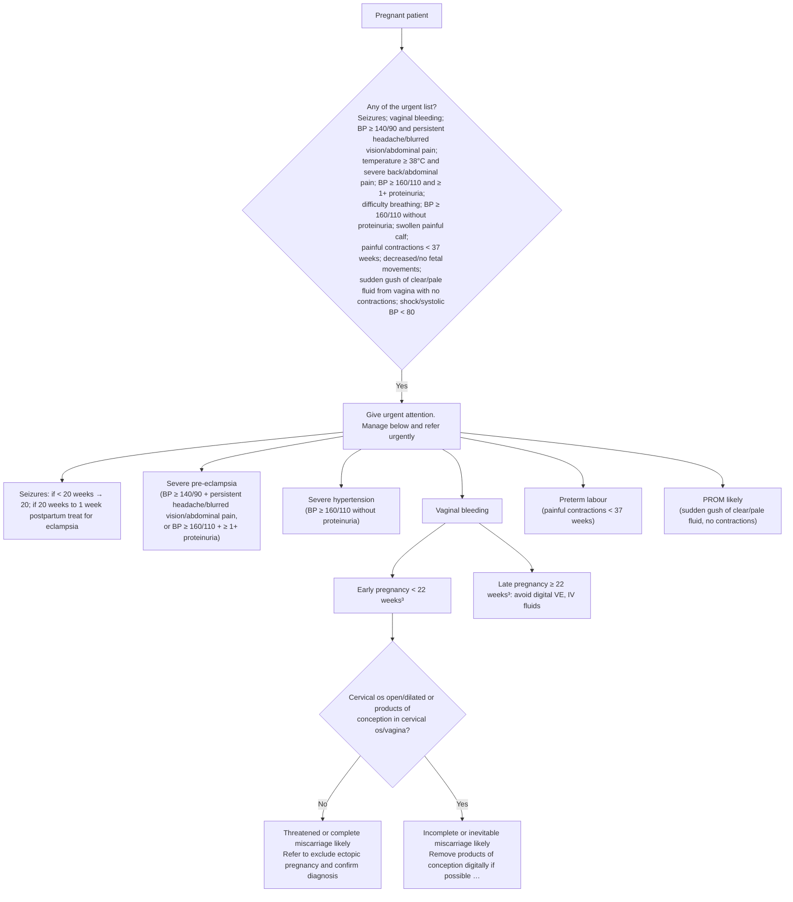

# Page 177 – Routine antenatal care: flowchart

Source: `inputs/2026/p177.png` (the red box: the urgent-attention list, then the management columns).

³ If gestation not known, manage as late pregnancy if uterus palpable above umbilicus.

## Decision nodes → rules

| Node | Modelled as | Rule |
|---|---|---|
| Pregnant patient (trigger) | `(active_condition Pregnancy)` | `Check for urgent signs in the pregnant patient (antenatal care)` |
| Urgent list = Yes | `(and Pregnancy (or …all twelve items…))` | `Urgent: pregnant patient with antenatal danger signs` |
| BP ≥ 140/90 + headache/blurred vision/abdominal pain; BP ≥ 160/110 + proteinuria | probable Severe pre-eclampsia | `Diagnose probable severe pre-eclampsia in pregnancy (antenatal care)` |
| BP ≥ 160/110 without proteinuria | written directly in the priority rule (no SNOMED concept for severe hypertension) | `Urgent: pregnant patient with antenatal danger signs` |
| Painful contractions < 37 weeks | possible Premature labor (gestational age not representable) | `Diagnose possible preterm labour from painful contractions in pregnancy` |
| Sudden gush of clear/pale fluid, no contractions | probable Premature rupture of membranes | `Diagnose probable prelabour rupture of membranes (antenatal care)` |
| Vaginal bleeding → cervical-os question | second `check_for` task | `Check cervical os and products of conception in pregnant patient with vaginal bleeding` |
| Q = No | possible Threatened abortion, possible Complete miscarriage, possible Ectopic pregnancy ("refer to exclude") | `Diagnose possible threatened miscarriage (antenatal vaginal bleeding)`, `Diagnose possible complete miscarriage (antenatal vaginal bleeding)`, `Diagnose possible ectopic pregnancy (antenatal vaginal bleeding, os closed)` |
| Q = Yes | possible Incomplete miscarriage, possible Inevitable abortion | `Diagnose possible incomplete miscarriage (antenatal vaginal bleeding)`, `Diagnose possible inevitable miscarriage (antenatal vaginal bleeding)` |
| Early < 22 weeks / late ≥ 22 weeks, Seizures < 20 weeks / eclampsia window | not modelled: gestational age has no unit in the language | — |

## Notes

- BP pairs are read as systolic **or** diastolic at or above the threshold.
- All management (oxygen, fluids, ceftriaxone, magnesium, nifedipine, betamethasone, anti-D,
  antibiotics for PROM) is out of scope.
