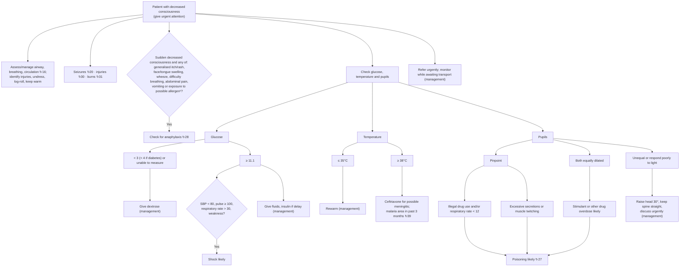

# Page 18 – Decreased consciousness: flowchart

Source: APC 2026 e-book page 18 (the whole page is one red box). The branches below are the
"Check glucose, temperature and pupils" tree inside the box.

¹ Common allergens include medication, food or insect bite/sting within the past few hours.

## Decision nodes → rules

| Node | Modelled as | Rule |
|---|---|---|
| Patient with decreased consciousness | `Decreased level of consciousness` → Urgent | `Urgent: decreased consciousness` |
| Checks on the page (pupils, drug use, secretions, twitching, weakness, anaphylaxis features, exposures) | `check_for` triggered by decreased consciousness | `Check for causes of decreased consciousness` |
| ANA = Yes | Sudden-onset decreased consciousness **and** any of the listed features or exposure to drug / food / insect bite / sting | `Consider anaphylaxis in sudden decreased consciousness` (possible) |
| Glucose ≥ 11.1 → Shock likely | Decreased consciousness **and** glucose ≥ 11.1 **and** any of SBP < 80, pulse ≥ 100, RR > 30, weakness | `Diagnose probable shock in decreased consciousness with glucose ≥ 11.1` |
| Temperature ≥ 38°C → possible meningitis | Decreased consciousness **and** temperature ≥ 38 | `Diagnose possible meningitis in decreased consciousness with fever` (possible) |
| Both equally dilated → Stimulant or other drug overdose likely | Decreased consciousness **and** dilated pupils, both eyes | `Diagnose probable overdose in decreased consciousness with dilated pupils` |
| Pinpoint branches / overdose → Poisoning likely | Decreased consciousness **and** (constricted pupils **and** (illicit drug use or RR < 12 or excessive salivation / bronchial secretion or muscle twitch)) **or** both pupils dilated | `Diagnose probable poisoning in decreased consciousness` |
| Glucose < 3, temperature ≤ 35°C, unequal/poorly reactive pupils | Lead only to management; not modelled | — |
| Seizures / injuries / burns / malaria / ABC pointers | Cross-references to other pages; not modelled | — |
