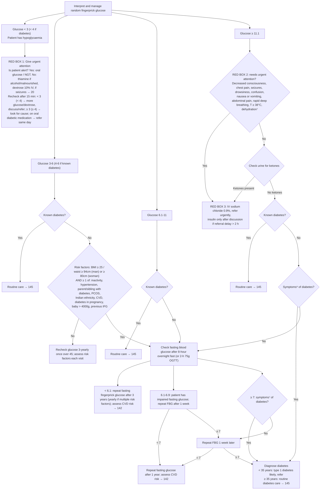

# Page 19 – Assess and manage glucose: flowchart

Source: `inputs/2026/p19.png` (APC 2026 e-book, page 19), with red boxes 1–3.

⁷ Thirst, dry mouth, poor skin turgor, BP < 90/60, pulse ≥ 100.
⁸ Unexplained weight loss, tiredness, thirst (especially at night), passing excessive amounts of urine
often, periodic changes in vision, frequent infections (e.g. urinary, skin).

## Decision nodes → rules

| Node | Modelled as | Rule |
|---|---|---|
| Glucose < 3 (< 4 if diabetes) | `Blood glucose status` < 3, or < 4 **and** known diabetes | `Diagnose probable hypoglycaemia from fingerprick glucose`; `Urgent: low fingerprick glucose (hypoglycaemia)` |
| "if diabetes" (low branch) | Known diabetes asked when glucose < 4 | `Check for known diabetes when glucose is low` |
| RED BOX 1 (Is patient alert? and everything below it) | Management only; not modelled | — (management_step / flowchart_routing in provenance) |
| Glucose 3-6, risk factors, recheck | Not modelled: the branch's only outputs are a fasting glucose check or a recheck, and there is no fasting-glucose observable | — (see remaining-questions) |
| Glucose 6.1-11 | Not modelled: output is a fasting glucose check | — |
| Glucose ≥ 11.1 → RED BOX 2 items | `check_for` all ten items | `Check for urgent high glucose conditions` |
| RED BOX 2 = Yes, or ketones present → RED BOX 3 | Glucose ≥ 11.1 **and** any box 2 item (temperature as a measurement) or Ketonuria | `Urgent: high glucose with danger signs or ketones` |
| Check urine for ketones | Ketonuria in the same `check_for` | `Check for urgent high glucose conditions` |
| No ketones → not known diabetes → symptoms⁸ = Yes → Diagnose diabetes | Glucose ≥ 11.1 **and** `(no Ketonuria)` **and** `(no known diabetes)` **and** any footnote-8 symptom | `Diagnose probable diabetes from random glucose >= 11.1 with symptoms` |
| Diagnose diabetes: < 35 years → type 1 likely | Not modelled: the language has no age criterion | — |
| Fasting glucose branch (< 6.1, 6.1-6.9 impaired fasting glucose, ≥ 7, repeat after 1 week) | Not modelled: no observable distinguishes a fasting from a random glucose | — |

## Notes

- All glucose values are the routine vital `Blood glucose status` in mmol/L.
- The page's bands (3-6, 6.1-11, ≥ 11.1) leave gaps between 6 and 6.1 and between 11 and 11.1;
  the only band edges used in rules are the page's own (< 3, < 4, ≥ 11.1).
