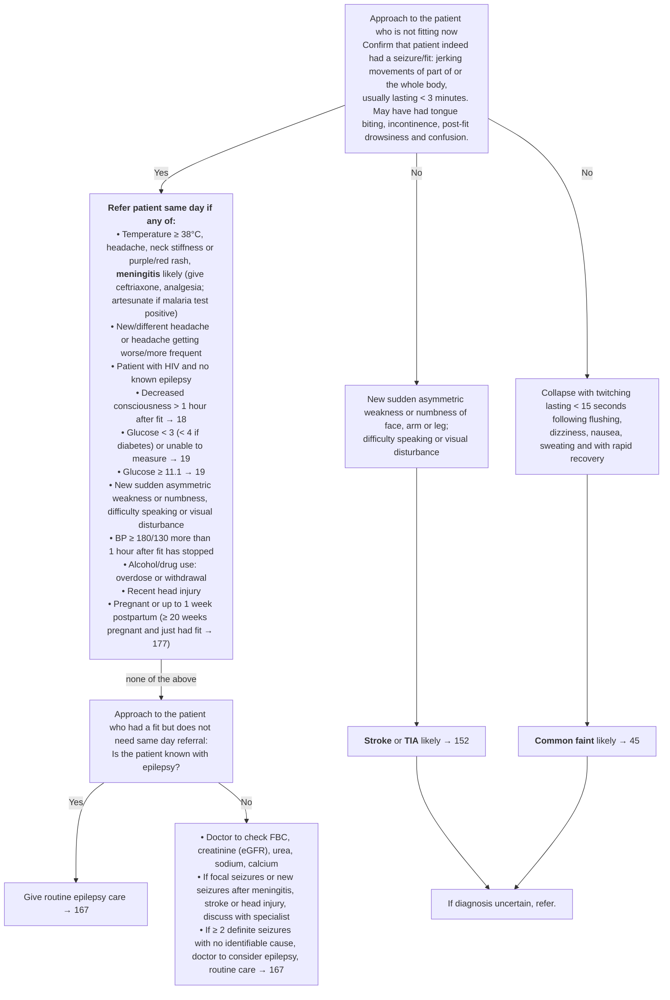

# Page 21 – Seizures/fits (cont. 2): flowchart

Source: APC 2026 e-book, page 21 (`inputs/2026/p21.png`, red box `p21-box1.png`).

## Decision nodes → rules

| Node | Modelled as | Rule |
|---|---|---|
| Entry: patient had (or is reported to have had) a fit | `(or Seizure Post-ictal state)`, both adult warning signs | trigger of `Check for seizure/fit same-day referral conditions` |
| Confirm seizure: Yes / No | Not modelled as a separate decision. The confirmation features (jerking, duration < 3 min, tongue biting, incontinence, post-fit drowsiness/confusion) are routing guidance, and "No" cannot be recorded without contradicting the trigger. All findings for both branches are in the one `check_for` | `Check for seizure/fit same-day referral conditions` |
| Red box, meningitis bullet | Seizure/post-ictal **and** any of temperature ≥ 38 °C, headache, stiff neck, purpuric rash | `Diagnose probable meningitis after a seizure/fit`; referenced as `(active_condition Meningitis)` |
| Red box, every other bullet | Seizure/post-ictal **and** `or` of the bullets | `Urgent: seizure/fit needing same-day referral` |
| No → focal deficit | Any of sudden-onset unilateral weakness/numbness of face or limb, difficulty talking, visual disturbance | `Diagnose probable stroke after a reported fit` (Cerebrovascular accident; TIA has no joint concept) |
| No → collapse with twitching after prodrome | Collapse **and** muscle twitch **and** any of flushing, dizziness, nausea, sweating. Duration < 15 s and rapid recovery not representable | `Diagnose probable common faint after a reported fit` |
| If diagnosis uncertain, refer | Management | not encoded |
| Does not need same-day referral → known epilepsy? | Management / routine care pointers | not encoded |
| ≥ 2 definite seizures, no identifiable cause → consider epilepsy | No SNOMED concept or count for "≥ 2 seizures"; "no identifiable cause" not representable | not encoded (see remaining questions) |

## Notes

- "Refer patient same day" is encoded as `Urgent`. The Seizure warning sign itself already carries
  Emergency and Post-ictal state Very urgent; this page does not escalate beyond same-day referral.
- "> 1 hour after fit" is `(>= (onset (clinical_finding Seizure)) (time_ago 1 hours))`
  (`>` changed to `>=` because the database rejects strict time comparisons).
