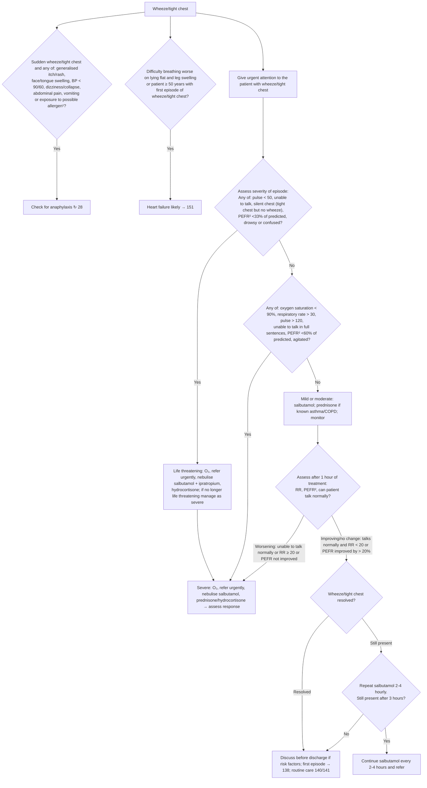

# Page 22 – Wheeze/tight chest: flowchart

Source: `inputs/2026/p22.png` (APC 2026, page 22; one red box plus two pre-box bullets).

¹ Common allergens include medication, food or insect bite/sting within the past few hours.
² PEFR expressed as a percentage of the predicted normal value.

## Decision nodes → rules

| Node | Modelled as | Rule |
|---|---|---|
| START (presenting complaint) | `Wheezing` or `Tight chest` finding | trigger of `Check for wheeze/tight chest severity and causes`, `Measure PEFR for wheeze/tight chest` |
| Red-box header | Every patient with wheeze/tight chest is Urgent | `Urgent: wheeze/tight chest` |
| Q1 = Yes (life threatening) | complaint **and** any of pulse < 50, Unable to speak, (tight chest **and no** wheezing), PEFR % predicted < 33, Drowsy, Acute confusion | `Emergency: life-threatening wheeze/tight chest` |
| Q1 = No → Q2 = Yes (severe) | complaint **and** any of SpO₂ < 90, RR > 30, pulse > 120, Unable to complete a sentence in one breath, PEFR % predicted < 60, Feeling agitated | `Urgent: severe wheeze/tight chest episode` |
| Q2 = No (mild/moderate) | No rule beyond the header's Urgent | `Urgent: wheeze/tight chest` |
| Q3–Q5 (reassessment after 1 h / 3 h of treatment) | Not modelled: response to treatment over time is management follow-up | — |
| PRE1 = Yes | sudden-onset wheezing/tight chest **and** any listed feature or exposure → `possible` anaphylaxis, which triggers page 28's checks | `Diagnose possible anaphylaxis from sudden wheeze/tight chest` |
| PRE2 = Yes | complaint **and** Orthopnea **and** Leg swelling symptom (age ≥ 50 branch not representable) | `Diagnose probable heart failure from wheeze/tight chest` |
