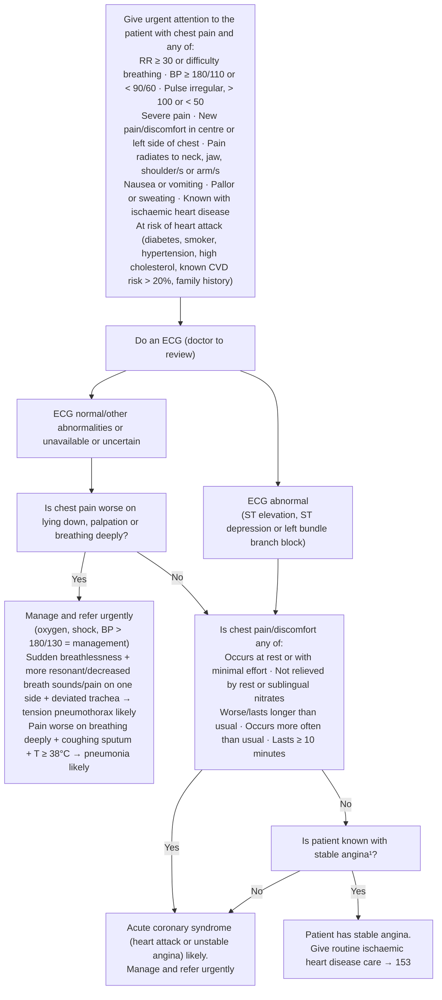

# Page 24 – Chest pain: flowchart

Source: `inputs/2026/p24.png` (APC 2026, page 24). The whole flowchart sits inside the red box,
below "Give urgent attention to the patient with chest pain and any of:".

¹ Chest pain caused by ischaemic heart disease.

Note: the image shows the line from "ECG abnormal" running into the top of the "Is chest
pain/discomfort any of" box (not straight to ACS), the same box that the "No" of Q1 enters.

## Decision nodes → rules

| Node | Modelled as | Rule |
|---|---|---|
| Red box (urgent criteria) | Chest pain **and** any red-box item | `Check for urgent chest pain conditions` (check_for), `Record known cardiovascular risk in chest pain` (measure), `Urgent: chest pain with danger signs or heart attack risk` |
| Do an ECG | ECG findings recorded: ST segment elevation, ST segment depression, Electrocardiographic left bundle branch block | `Check for urgent chest pain conditions` (check_for) |
| ECG abnormal | `(or ST elevation, ST depression, LBBB)` | `Diagnose probable acute coronary syndrome from chest pain`, first `or` |
| Q1 = No | `(and (no Tenderness of chest wall) (no Chest pain on breathing))`; "worse on lying down" has no SNOMED concept | `Diagnose probable acute coronary syndrome from chest pain`, first `or` |
| Q1 = Yes | `(or Tenderness of chest wall, Chest pain on breathing)` triggers the Yes-branch check | `Check for tension pneumothorax and pneumonia in chest pain worse on palpation or breathing` |
| Tension pneumothorax likely | Q1 = Yes **and** sudden-onset dyspnoea **and** (hyperresonance or decreased breath sounds or left/right-sided chest pain) **and** trachea displaced | `Diagnose probable tension pneumothorax from chest pain`; `Urgent: probable tension pneumothorax from chest pain` |
| Pneumonia likely | Chest pain on breathing **and** productive cough **and** temperature ≥ 38 °C | `Diagnose probable pneumonia from pleuritic chest pain`; `Urgent: probable pneumonia from pleuritic chest pain` |
| Q2 = Yes | Chest pain at rest, chest pain worsening, chest pain prolonged, chest pain onset ≥ 10 minutes ago ("not relieved by rest or nitrates", "minimal effort" and "more often than usual" have no concept) | `Diagnose probable acute coronary syndrome from chest pain`, second `or` |
| Q3 = No | `(no (clinical_finding Stable angina, Known present))` | `Diagnose probable acute coronary syndrome from chest pain`, second `or` |
| ACS likely → manage and refer urgently | `(active_condition Acute coronary syndrome)` → Urgent | `Urgent: probable acute coronary syndrome from chest pain` |
| Q3 = Yes → stable angina | Not modelled as a diagnosis: the evidence is the known diagnosis itself; routes to routine care (page 153) | — |

## Notes

- The diagnosis rules are not gated on the red-box criteria, although the flowchart sits inside
  the red box. They can therefore fire for a chest-pain patient who meets none of the red-box items.
- The ECG-normal precondition of the Yes branch (tension pneumothorax, pneumonia) is not modelled.
- Management lines (oxygen, aspirin, IV access, nitrates, morphine, streptokinase, saline for
  shock, amlodipine, ceftriaxone, chest drain) are out of scope.
