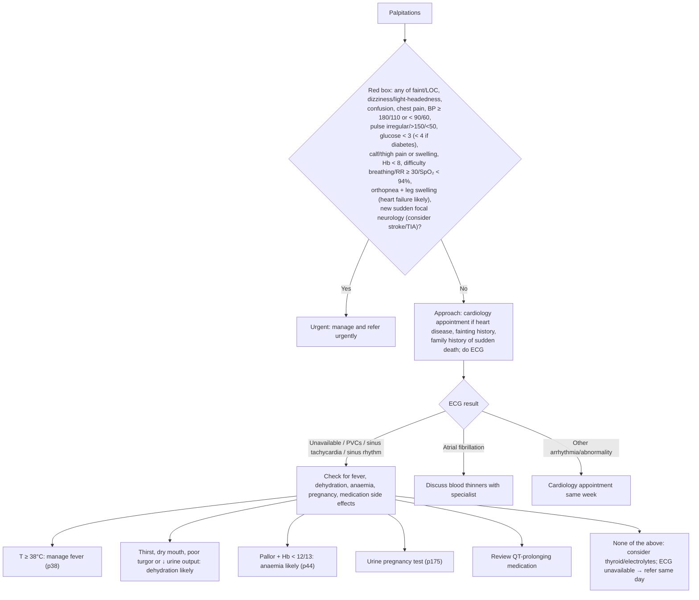

# Page 26 – Palpitations: flowchart

Source: `inputs/2026/p26.png` (APC 2026, page 26).

## Decision nodes → rules

| Node | Modelled as | Rule |
|---|---|---|
| Palpitations (entry) | `(clinical_finding Palpitations)` trigger | `Check for urgent palpitations conditions`, `Check for dehydration in palpitations` |
| Red box | `(and Palpitations (or …all criteria except Hb < 8…))` | `Urgent: palpitations with danger signs` |
| Heart failure likely | Palpitations + Orthopnea + Leg swelling symptom → probable; priority uses `(active_condition Heart failure)` | `Diagnose probable heart failure in palpitations` |
| Consider stroke/TIA | Palpitations + any sudden-onset weakness/numbness/difficulty talking/visual disturbance → possible | `Diagnose possible stroke in palpitations`, `Diagnose possible TIA in palpitations` |
| Dehydration likely | Palpitations + any of thirst, xerostomia, decreased skin turgor, decreased urine output → probable | `Diagnose probable dehydration in palpitations` |
| ECG branches, AF, other arrhythmia | Not modelled (ECG results not recorded; management) | — |
| Fever, anaemia, pregnancy, medication, thyroid/electrolytes | Not modelled (pointer, Hb, urine test, management, "none of the above") | — |
