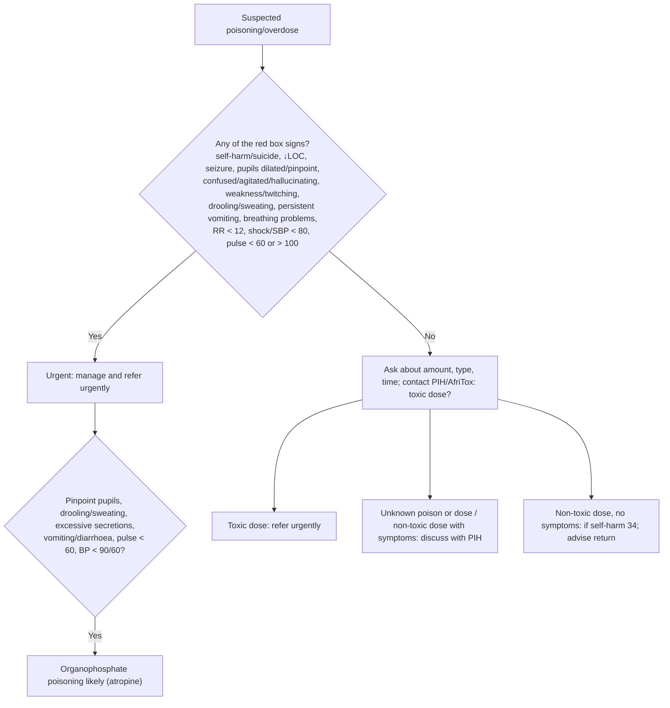

# Page 27 – Poisoning/Overdose: flowchart

Source: `inputs/2026/p27.png`. The page is a red box (urgent list + management) and a short
routing chart for the patient not needing urgent attention.

## Decision nodes → rules

| Node | Modelled as | Rule |
|---|---|---|
| Suspected poisoning/overdose | `(clinical_finding Poisoning)` (warning sign) | trigger of `Check for urgent poisoning/overdose conditions` |
| Red box "any of" | `(and Poisoning (or …13 items…))` | `Urgent: poisoning/overdose with danger signs` |
| Organophosphate signs | `(and Poisoning (or signs))` | `Diagnose probable organophosphate poisoning` |
| Toxic / unknown / non-toxic dose | Not modelled: needs a toxic-dose judgment from PIH, management routing | — |
