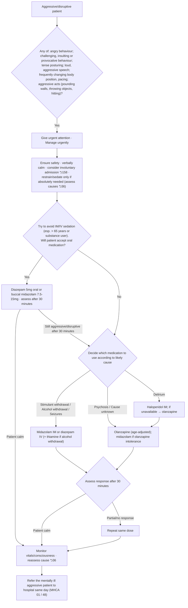

# Page 35 – Aggressive/Disruptive Behaviour: flowchart

Source: `inputs/2026/p35.png` (one red box). The red box opens with the urgent-attention criteria;
everything below "Manage urgently" is a sedation algorithm (management only, not encoded).

## Decision nodes → rules

| Node | Modelled as | Rule |
|---|---|---|
| Presenting complaint | `(or Aggressive behavior, Disruptive behavior)` | trigger of `Check for urgent aggressive/disruptive behaviour signs` |
| Urgent-attention criteria (U = Yes) | complaint **and** `or` of the eight findings | `Urgent: aggressive/disruptive behaviour with red-box signs` |
| Will patient accept oral medication? | not modelled (management) | — |
| Patient calm / still aggressive after 30 minutes | not modelled (management reassessment) | — |
| Decide medication by likely cause | not modelled: the causes only select a medicine; the page states no "X likely" with evidence | — |
| Assess response / repeat dose / monitor / refer | not modelled (management, referral) | — |
