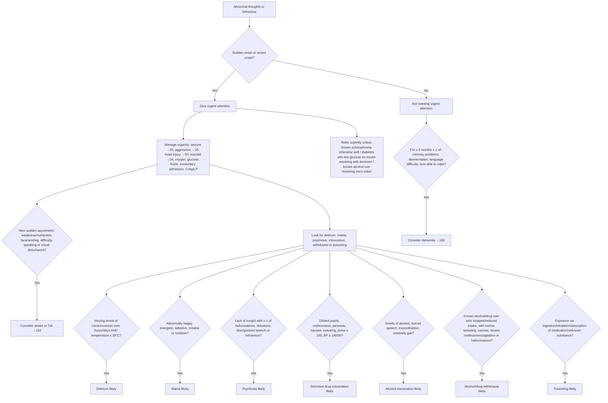

# Page 36 – Abnormal thoughts or behaviour: flowchart

APC 2026 page 36. The red box holds the urgent-attention criteria, a "Manage urgently" list and a
row of seven "look for" boxes, each leading to an "X likely" box. Below the red box is the approach
to the patient not needing urgent attention (dementia).

## Decision nodes

| Node | Page wording | Rule |
|---|---|---|
| A / B | "Give urgent attention to the patient with abnormal thoughts or behaviour and any of: Sudden onset … Recent onset …" | Task "Check for abnormal thoughts or behaviour features"; priority "Urgent: abnormal thoughts or behaviour of sudden or recent onset" |
| S | "If new sudden asymmetric weakness or numbness of face/arm/leg, difficulty speaking or visual disturbance, consider stroke or TIA" | "Diagnose possible stroke in abnormal thoughts or behaviour", "Diagnose possible TIA in abnormal thoughts or behaviour" |
| D1 | "Varying levels of consciousness over hours/days and temperature ≥ 38°C" → "Delirium likely" | "Diagnose probable delirium in abnormal thoughts or behaviour" |
| D2 | "Abnormally happy, energetic, talkative, irritable or reckless" → "Mania likely" | "Diagnose probable mania in abnormal thoughts or behaviour" |
| D3 | "Lack of insight with ≥ 1 of: …" → "Psychosis likely" | "Diagnose probable psychosis in abnormal thoughts or behaviour" |
| D4 | "Dilated pupils, restlessness, paranoia, nausea, sweating, pulse ≥ 100, BP ≥ 140/90" → "Stimulant drug intoxication likely" | "Diagnose probable stimulant intoxication in abnormal thoughts or behaviour" |
| D5 | "Smells of alcohol, slurred speech, incoordination, unsteady gait" → "Alcohol intoxication likely" | "Diagnose probable alcohol intoxication in abnormal thoughts or behaviour" |
| D6 | "Known alcohol/drug user who has stopped/reduced intake with …" → "Alcohol/drug withdrawal likely" | "Diagnose probable alcohol/drug withdrawal in abnormal thoughts or behaviour" |
| D7 | "Exposure via ingestion/inhalation/absorption of medication/unknown substance" → "Poisoning likely" | "Diagnose probable poisoning in abnormal thoughts or behaviour" |
| DM | "If for at least 6 months ≥ 1 of: … consider dementia" | "Diagnose possible dementia in abnormal thoughts or behaviour" |
| MU, R | Manage urgently items, Refer urgently unless | Not encoded (management steps and cross-references) |
