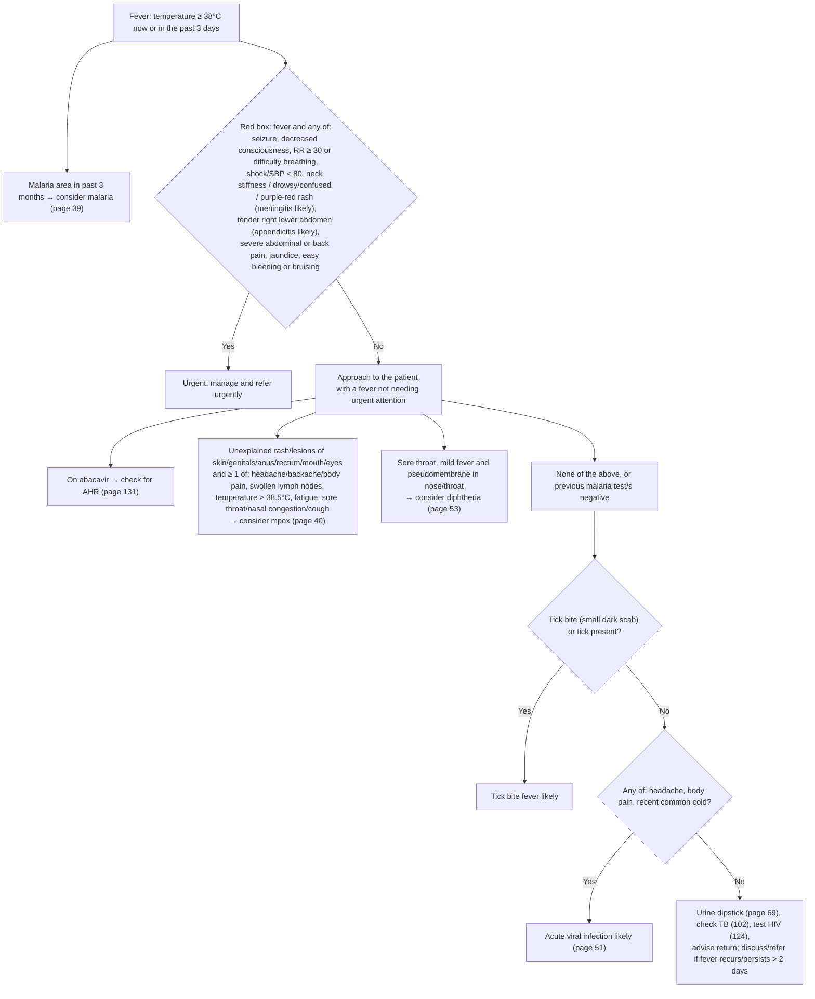

# Page 38 – Fever: flowchart

Source: `inputs/2026/p38.png` (APC 2026, page 38).

## Decision nodes → rules

| Node | Modelled as | Rule |
|---|---|---|
| DEF | Body temperature ≥ 38 °C → probable Fever ("in the past 3 days" not modelled) | `Diagnose probable fever from temperature ≥ 38°C` |
| Red box (trigger) | `(active_condition Fever)` → check for the red-box findings | `Check for urgent fever conditions` |
| Red box: meningitis likely | Fever **and** any of stiff neck, drowsy, acute confusion, purpuric rash | `Diagnose probable meningitis in fever` |
| Red box: appendicitis likely | Fever **and** tenderness of right lower quadrant | `Diagnose probable appendicitis in fever` |
| Red box → Urgent | Fever **and** any red-box item (meningitis/appendicitis via `active_condition`) | `Urgent: fever with danger signs` |
| MAL | Not encoded (no SNOMED concept for travel to / residence in a malaria area); page 39 handles malaria | – |
| ABC | Cross-reference only | – |
| MPOX | Fever **and** (rash or lesion at any listed site) **and** any of the listed symptoms or temperature > 38.5 °C | `Diagnose possible mpox in fever` |
| DIPH | Fever **and** sore throat **and** pseudomembrane in pharynx or nasal cavity | `Diagnose possible diphtheria in fever` |
| TICK = Yes | Fever **and** (tick bite or tick infestation) | `Diagnose probable tick bite fever` |
| TICK = No → VIR = Yes | Fever **and** no tick bite **and** no tick infestation **and** any of headache, generalized aches and pains, common cold | `Diagnose probable acute viral infection in fever` |
| REST | Management / cross-references only | – |

Shared task for the non-urgent approach: `Check for causes of fever not needing urgent attention`.

## Notes

- "If none of the above" (no mpox, no diphtheria) before the tick question is not modelled as a
  negation; the tick and viral rules can fire alongside a possible mpox/diphtheria diagnosis.
- "Previous malaria test/s negative" is not modelled (no lab result representation).
