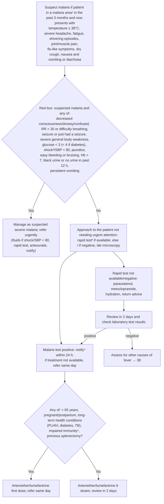

# Page 39 – Malaria: flowchart

Source: `inputs/2026/p39.png` (APC 2026, page 39). The page has one red box and a lower
"approach to the patient not needing urgent attention" algorithm with a Yes/No branch.

## Decision nodes → rules

| Node | Modelled as | Rule |
|---|---|---|
| Who to ask about malaria exposure | Any of the page's suspicion symptoms that the app records (fever, temperature ≥ 38, headache, fatigue, muscle pain, cough, nausea, vomiting, diarrhoea) → ask about recent travel to a malaria area and the remaining symptoms | `Check for malaria exposure and symptoms` |
| S: suspect malaria | Travel with high risk of exposure, recorded within the past 3 months, **and** any of the listed symptoms | `Diagnose possible malaria` |
| RB: red box items | `check_for` of every red-box item the language can express | `Check for urgent signs of suspected malaria` |
| RB = Yes | `(and (diagnosis Malaria possible) (or …red box…))` | `Urgent: suspected malaria with danger signs` |
| RB = No → approach, tests, risk question, treatment | Malaria test results are laboratory results; branches lead only to management (medicines, referral, notification, review) | Not modelled (management / lab) |
| "Other causes of fever → 38" | Cross-reference | Not modelled |

## Notes

- "Shock²/systolic BP < 80" is encoded on this page only, as `(or Shock SBP < 80)`. Footnote 2
  ("If systolic BP < 80, pulse ≥ 100, respiratory rate > 30, confusion/restlessness, weakness, shock
  likely") is not turned into a shared shock rule.
- Hb < 7 has no unit/observable in the language and is not modelled.
- The risk question (> 65 years, pregnancy, chronic conditions, splenectomy) only chooses between two
  treatment regimens, so it carries no triage or diagnostic logic.
