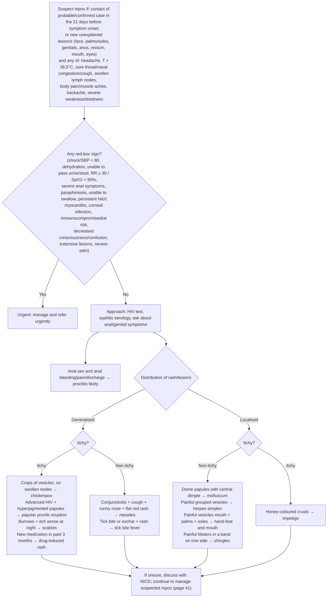

# Page 40 – Mpox: diagnosis and management: flowchart

Source: APC 2026 e-book, page 40 (top band, red box, and the lower "Approach to the patient with
suspected mpox not needing urgent attention" algorithm).

## Decision nodes → rules

| Node | Modelled as | Rule |
|---|---|---|
| What prompts the questions | A recorded skin lesion, eruption, or face/genital/rectal/oral/eye lesion | `Check for mpox exposure, lesion sites and associated symptoms` |
| Suspect mpox (S) | Exposure to monkeypox virus within 21 days, **or** (new lesion at a listed site **and** any listed symptom) | `Diagnose possible mpox (contact or new lesions with systemic symptoms)` |
| Red box (RB) questions | Checked when mpox is possible | `Check for urgent mpox danger signs` |
| RB = Yes | Possible mpox **and** any red-box item; "X likely" items through their probable rules | `Urgent: suspected mpox with danger signs`, plus `Diagnose probable dehydration/proctitis/paraphimosis/myocarditis/corneal infection in suspected mpox` |
| Approach questions | Checked when mpox is possible | `Check for proctitis and other causes of rash/lesions in suspected mpox` |
| Proctitis (PR) | Anal penetration **and** anal bleeding/pain/discharge (or a severe red-box anal symptom) | `Diagnose probable proctitis in suspected mpox` |
| Generalised + itchy (G1) | Generalized rash **and** Itching **and** the specific signs | `… chickenpox …`, `… papular pruritic eruption …`, `… scabies …`, `… drug-induced rash …` |
| Generalised + non-itchy (G2) | Generalized rash **and** (no Itching) **and** the specific signs | `… measles …`, `… tick bite fever …` |
| Localised + non-itchy (L1) | Localized skin lesion **and** (no Itching) **and** the specific signs | `… herpes simplex …`, `… hand-foot and mouth disease …`, `… shingles …`; molluscum not encoded (no concept for a central dimple) |
| Localised + itchy (L2) | Localized skin lesion **and** Itching **and** crust on skin | `Diagnose probable impetigo in suspected mpox` |
| NICD / page 41 | Management and cross-reference | not encoded |

## Notes

- Every probable rule is and-ed with `(diagnosis Monkeypox possible)`, which is this page's context.
- "If rash or lesions all look similar … mpox is more likely" is a relative statement, not "mpox likely"; it is not encoded.
