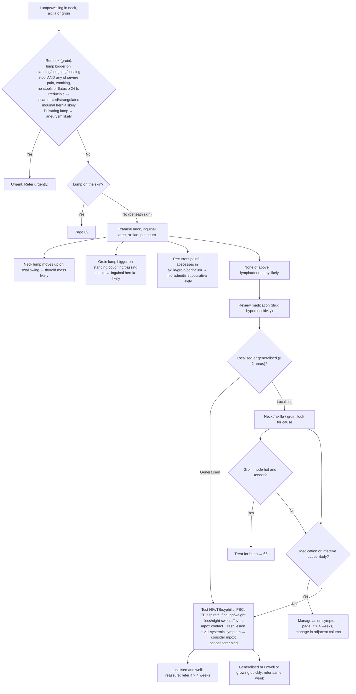

# Page 42 – Lump/swelling in neck, axilla or groin: flowchart

Source: `inputs/2026/p42.png` (APC 2026, page 42).

## Decision nodes → rules

| Node | Modelled as | Rule |
|---|---|---|
| Lump site | Mass of body region → check Mass of neck / Mass of axilla / Groin mass / Mass of skin | `Check for site of lump/swelling in neck, axilla or groin` |
| Red box, hernia | Groin mass + cough impulse + (severe pain, vomiting, obstipation ≥ 24 h, irreducible groin mass) | `Diagnose probable incarcerated/strangulated inguinal hernia from lump in groin` |
| Red box, aneurysm | Groin mass qualified Pulsatile | `Diagnose probable aneurysm from pulsating lump in groin` |
| Red box → Urgent | Groin mass and either active condition | `Urgent: lump/swelling in groin with incarcerated/strangulated hernia or aneurysm` |
| Thyroid mass likely | Mass of neck + Thyroid gland moves with swallowing | `Diagnose probable thyroid mass from lump in neck` |
| Inguinal hernia likely | Groin mass + Cough impulse in inguinal canal | `Diagnose probable inguinal hernia from lump in groin` |
| HS likely | Recurrent abscess at axillary / inguinal / perineal site | `Diagnose probable hidradenitis suppurativa from recurrent abscesses in axilla, groin or perineum` |
| None of above → lymphadenopathy | Lump in neck/axilla/groin, no skin lump, none of the three discriminating findings | `Diagnose probable lymphadenopathy from lump in neck, axilla or groin` |
| Consider mpox | Lymphadenopathy + exposure to monkeypox virus + lesion + ≥ 1 systemic symptom | `Check for mpox in patient with lymphadenopathy`, `Diagnose possible mpox in patient with lymphadenopathy` |
| Localised/generalised, medication/infective cause, bubo, referral boxes | Not modelled (routing/management; bubo has no SNOMED disorder) | — |
