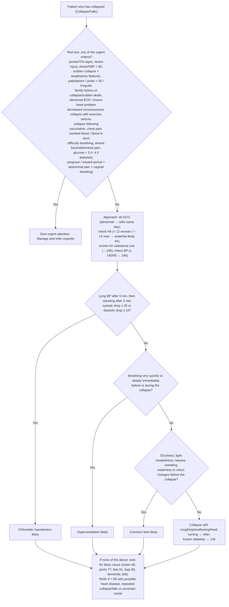

# Page 45 – Collapse/Falls: flowchart

Source: `inputs/2026/p45.png` (APC 2026, page 45). The red box is a flat "any of" list; the
flowchart below it is "Approach to the patient who has collapsed not needing urgent attention".

## Decision nodes → rules

| Node | Modelled as | Rule |
|---|---|---|
| Presenting complaint | `Collapse` (finding) or `Falls` (finding) | `due_to` of `Check for urgent collapse/falls conditions`, `Check for cause of collapse/falls`, `Measure postural blood pressure drop after collapse/falls`; first `and` term of `Urgent: collapse/falls with danger signs` |
| Red box (any of) | `(and complaint (or …all red-box items…))` | `Urgent: collapse/falls with danger signs`; items checked for in `Check for urgent collapse/falls conditions` |
| Red box: "consider stroke or TIA" | Sudden-onset face/arm/leg weakness or numbness, difficulty talking, visual disturbance | `Collapse/falls: consider stroke`, `Collapse/falls: consider TIA` (possible) |
| Red box: "Sudden collapse and any of … check for anaphylaxis" | Sudden-onset collapse **and** any of the listed features or exposure to a footnote-1 allergen | `Collapse/falls: check for possible anaphylaxis` (possible; triggers the anaphylaxis page's check) and a branch of the Urgent rule |
| Approach: ECG | `Electrocardiogram abnormal` is already a red-box item; "refer same day" is management | — |
| Approach: Hb → anaemia likely | Haemoglobin has no observable/unit in the language | Not encoded (see remaining questions) |
| Approach: substance use, BP ≥ 140/90 | Routing to other pages | Not encoded |
| Q1 = Yes | Level of reduction in systolic BP on standing ≥ 20 mmHg (diastolic drop not representable) | `Diagnose probable orthostatic hypotension after collapse/falls`; measured by `Measure postural blood pressure drop after collapse/falls` |
| Q1 = No → Q2 = Yes | Tachypnoea or excessively deep breathing | `Diagnose probable hyperventilation after collapse/falls` |
| Q2 = No → Q3 = Yes | Any of dizziness, light-headedness, nausea, sweating, weakness (asthenia), visual disturbance | `Diagnose probable common faint after collapse/falls` |
| Q3 = No, bottom box | Referral / routing | Not encoded (management, routing) |

## Notes

- The "No" preconditions of Q2 and Q3 (no postural drop; no fast/deep breathing) are **not**
  encoded, following the gold standard's handling of sequential questions; the three "likely"
  rules can therefore fire together. "Before / during the collapse" timing is not modelled.
- BP drop: only the systolic arm can be expressed (`Level of reduction in systolic blood pressure
  on standing`); there is no diastolic counterpart in SNOMED.
