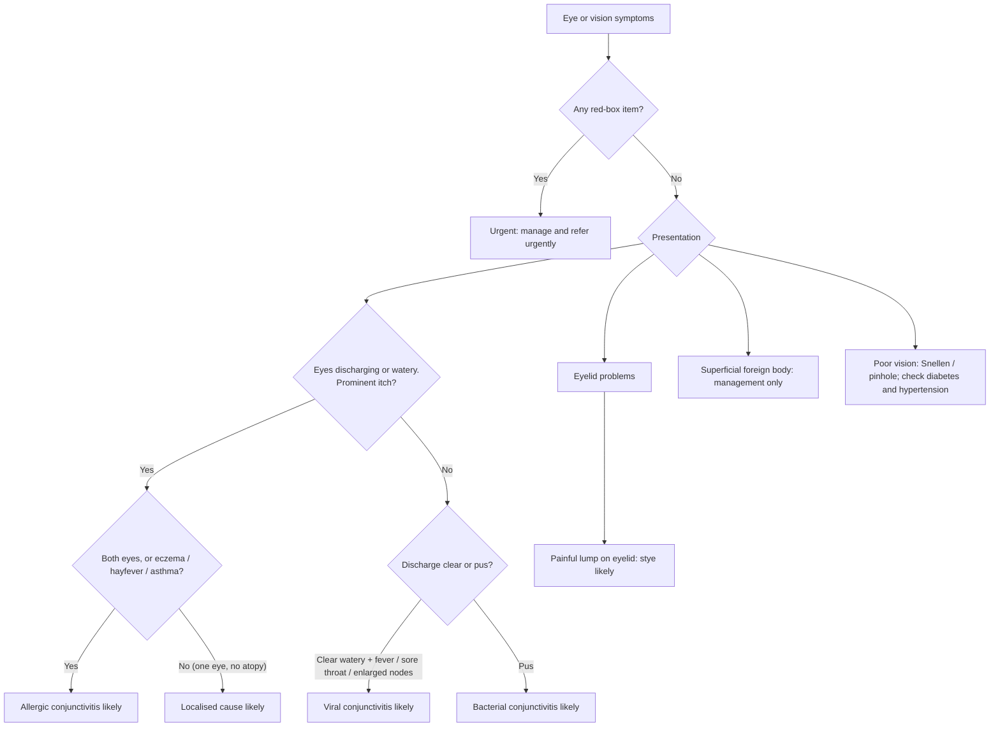

# Page 48 – Eye/vision symptoms: flowchart

| Node | Content | Rule |
|---|---|---|
| A | Trigger | `Check for urgent eye/vision conditions`, `Check for causes of non-urgent eye/vision symptoms` |
| B / U | Red box | `Urgent: eye/vision symptoms with danger signs` (with `Diagnose probable stroke or TIA in a patient with eye/vision symptoms`, `Diagnose probable gonococcal conjunctivitis`, `Diagnose probable orbital cellulitis`, `Diagnose probable jaundice from yellow eyes`, `Diagnose probable acute glaucoma in a patient with eye/vision symptoms`) |
| D, E, F | Itch yes, both eyes or atopy | `Diagnose probable allergic conjunctivitis` |
| G | Localised cause likely | Not encoded (no SNOMED concept; see remaining questions) |
| H, I | Itch no, clear discharge | `Diagnose probable viral conjunctivitis` |
| H, J | Itch no, pus | `Diagnose probable bacterial conjunctivitis` |
| L | Stye likely | `Diagnose probable stye` |
| M, N | Management / vision testing | Not encoded (management; visual acuity has no unit) |
