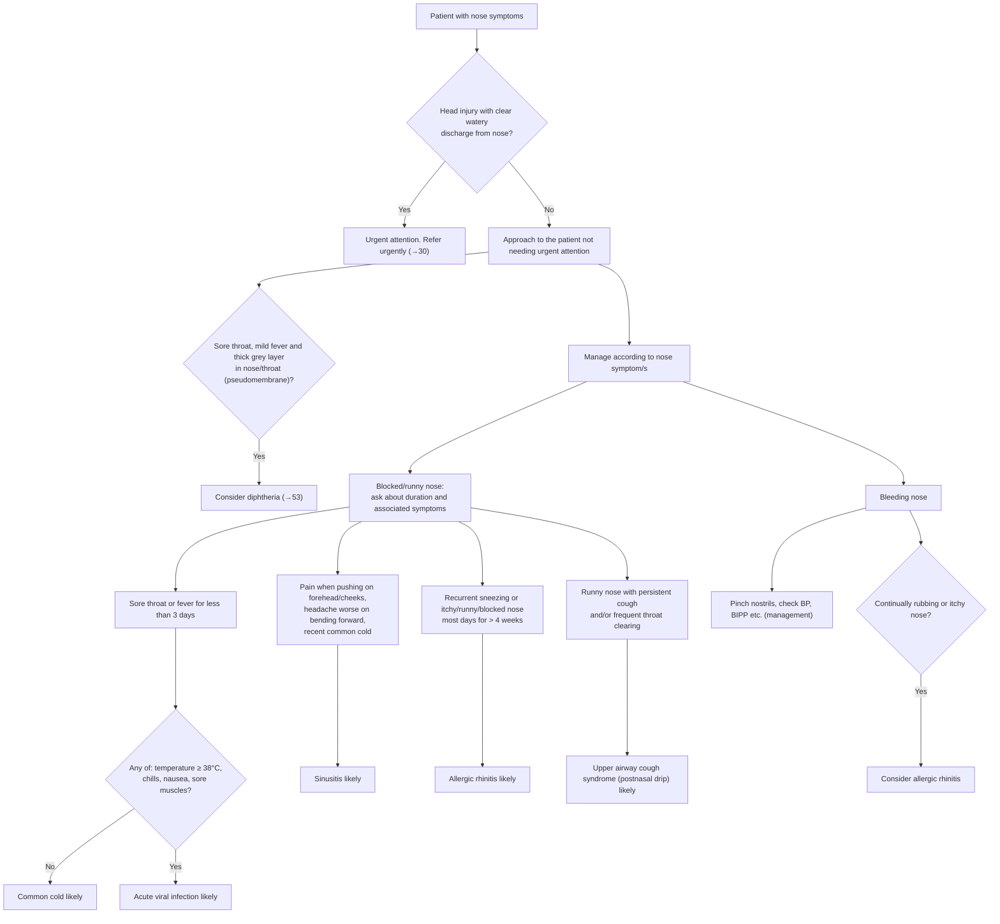

# Page 51 – Nose symptoms: flowchart

Source: APC 2026 e-book page 51 (`inputs/2026/p51.png`).

## Decision nodes → rules

| Node | Modelled as | Rule |
|---|---|---|
| Nose symptoms (trigger) | `(clinical_finding "Nose finding")`; Nasal discharge, Nasal obstruction and Bleeding from nose are all descendants | `Check for urgent nose symptom conditions` |
| Red box | Nose finding **and** Injury of head **and** Nasal discharge qualified Clear + Watery | `Urgent: nose symptoms with head injury and clear watery discharge` |
| Diphtheria | Sore throat **and** Fever **and** pseudomembrane in nose or pharynx | `Diagnose possible diphtheria from nose symptoms` |
| Blocked/runny nose | `(or Nasal discharge, Nasal obstruction)` | `Check for causes of blocked or runny nose`, and the first clause of each blocked/runny diagnosis rule |
| Sore throat or fever < 3 days, Any of = No | blocked/runny **and** sore throat or fever with onset within 3 days **and** temperature < 38 **and** no chill, no muscle pain, no nausea | `Diagnose probable common cold from nose symptoms` |
| Sore throat or fever < 3 days, Any of = Yes | blocked/runny **and** sore throat or fever with onset within 3 days **and** (temperature ≥ 38 or chill or muscle pain or nausea) | `Diagnose probable acute viral infection from nose symptoms` |
| Sinusitis | blocked/runny **and** tenderness over frontal or maxillary sinus **and** recent common cold (headache worse on bending: SNOMED gap) | `Diagnose probable sinusitis from nose symptoms` |
| Allergic rhinitis | sneezing, itchy nose, runny nose or blocked nose with onset ≥ 4 weeks ago | `Diagnose probable allergic rhinitis from nose symptoms` |
| Upper airway cough syndrome | runny nose **and** (persistent cough or frequent throat clearing) | `Diagnose probable postnasal drip from nose symptoms` |
| Bleeding nose → rubbing/itchy | bleeding from nose **and** itchy nose (rubbing: SNOMED gap) | `Diagnose possible allergic rhinitis from nosebleed` |
| Bleeding nose management, BP check | Management; BP is a routine vital | not encoded |
