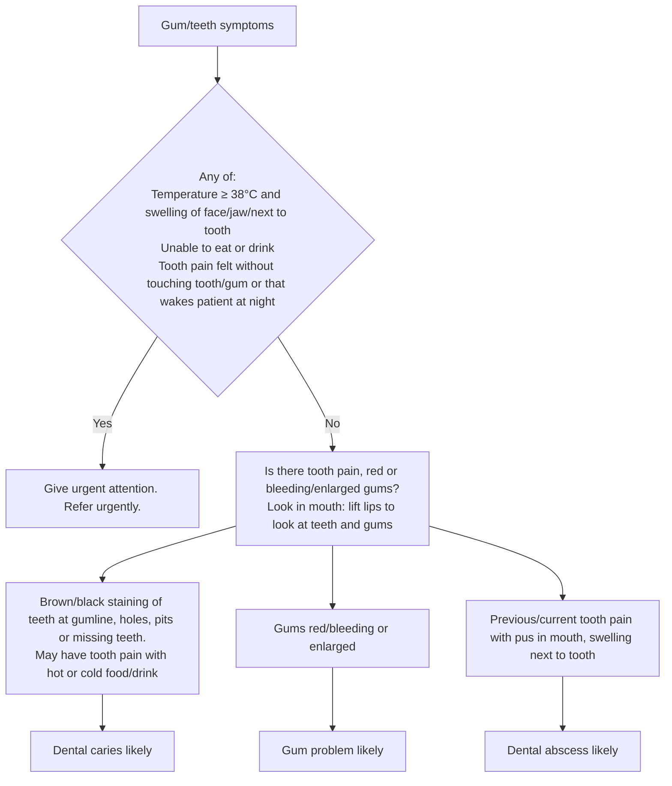

# Page 54 – Gum/teeth symptoms: flowchart

Source: APC 2026 page 54 (red box, then the "not needing urgent attention" approach with three branches).

## Decision nodes → rules

| Node | Modelled as | Rule |
|---|---|---|
| Gum/teeth symptoms | Tooth finding or Gingivae finding | trigger of `Check for urgent and likely gum/teeth conditions`; first conjunct of `Urgent: gum/teeth symptoms with danger signs` |
| Red box | (temp ≥ 38 °C and (facial / jaw / next-to-tooth swelling)) or unable to eat or unable to drink or spontaneous toothache or night-time toothache | `Urgent: gum/teeth symptoms with danger signs` |
| B1 → Dental caries likely | Staining of tooth or cavity in tooth or tooth absent | `Diagnose probable dental caries (gum/teeth symptoms)` |
| B2 → Gum problem likely | Gingival erythema or bleeding gums or gingival enlargement | `Diagnose probable gum problem (gum/teeth symptoms)` |
| B3 → Dental abscess likely | Toothache and pus in mouth and swelling next to tooth | `Diagnose probable dental abscess (gum/teeth symptoms)` |
