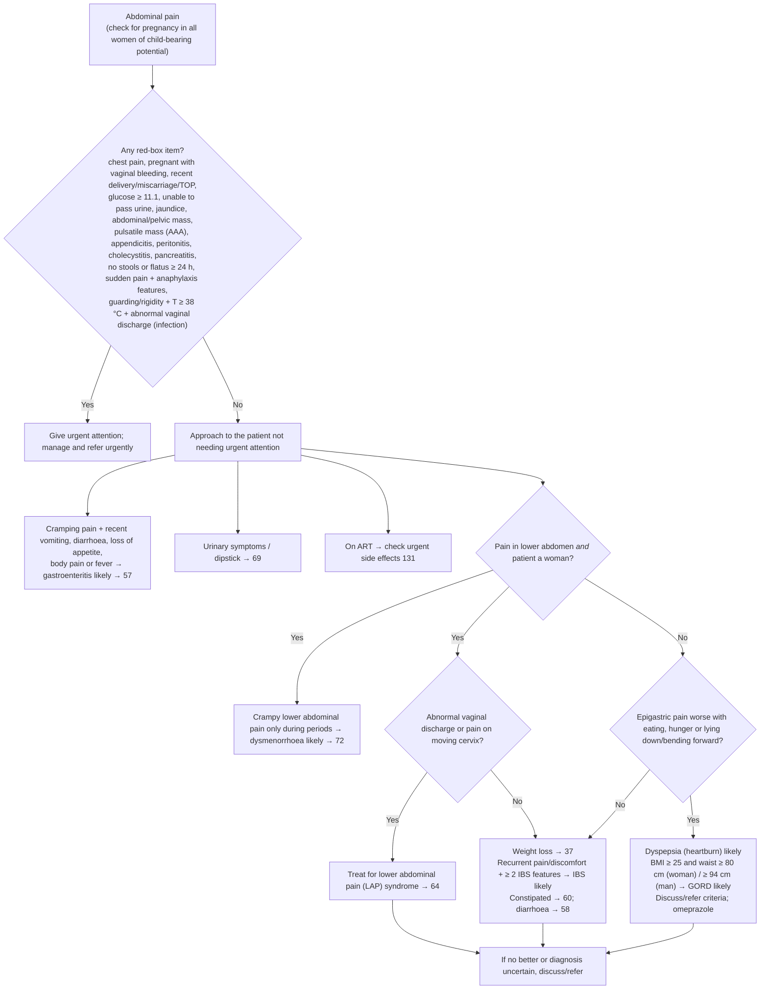

# Page 56 – Abdominal pain: flowchart

Source: `inputs/2026/p56.png` (APC 2026, page 56). Red box first, then the approach for the patient
not needing urgent attention.

## Decision nodes → rules

| Node | Modelled as | Rule |
|---|---|---|
| Presenting complaint | `Abdominal pain` (a warning sign) | `Check for urgent abdominal pain conditions`, `Check for non-urgent causes of abdominal pain` |
| Pulsatile abdominal mass | `Pulsatile mass of abdomen` | `Diagnose probable abdominal aortic aneurysm (abdominal pain)` |
| RLQ pain + nausea/vomiting/fever | `Right lower quadrant pain` and any of nausea, vomiting, fever | `Diagnose probable appendicitis (abdominal pain)` |
| Guarding or rigidity | `Abdominal guarding` or `Abdominal rigidity` | `Diagnose probable peritonitis (abdominal pain)` |
| Severe RUQ pain + nausea/fever/loss of appetite | `Right upper quadrant pain` + Severe, and any of nausea, fever, loss of appetite | `Diagnose probable cholecystitis (abdominal pain)` |
| Sudden severe upper pain to back + nausea/vomiting | `Upper abdominal pain` + Sudden onset + Severe, radiating to back, and nausea or vomiting | `Diagnose probable pancreatitis (abdominal pain)` |
| Guarding/rigidity + T ≥ 38 °C + abnormal vaginal discharge | all three | `Diagnose probable infection (abdominal pain with guarding, fever and vaginal discharge)` |
| Sudden abdominal pain + anaphylaxis features | sudden-onset abdominal pain and any of the listed features or an allergen exposure | `Diagnose possible anaphylaxis (sudden abdominal pain)` (routes to page 28's check); also a branch of the urgent rule |
| Any red-box item | `(and Abdominal pain (or …))` | `Urgent: abdominal pain with danger signs` |
| Gastroenteritis likely | `Abdominal colic` and any of vomiting, diarrhoea, loss of appetite, body aches, fever | `Diagnose probable gastroenteritis (abdominal pain)` |
| Lower abdomen and woman? | not modelled (the language has no sex criterion) | — |
| Dysmenorrhoea likely | `Menstrual cramp` | `Diagnose probable dysmenorrhoea (abdominal pain)` |
| Abnormal discharge or pain on moving cervix → LAP syndrome | not a "likely" diagnosis and no SNOMED concept for LAP syndrome; routing only | — |
| Epigastric pain worse with eating/hunger/lying → dyspepsia likely | `Epigastric pain` + Postprandial, or `Hunger pain` (lying/bending: no concept) | `Diagnose probable dyspepsia (abdominal pain)` |
| GORD likely | dyspepsia evidence and BMI ≥ 25 and waist ≥ 80/≥ 94 cm | `Diagnose probable gastro-oesophageal reflux disease (abdominal pain)`; waist measured by `Measure waist circumference for dyspepsia` |
| IBS likely | recurrent pain/discomfort and ≥ 2 of distension, stool frequency/appearance change, mucus in stool (pain relieved by stool: no concept) | `Diagnose probable irritable bowel syndrome (abdominal pain)` |
| Pointers 24, 177, 182, 19, 69, 28, 57, 72, 64, 37, 60, 58, 131, 164, 156 | cross-references | — |

## Notes

- The flowchart's branch conditions ("not needing urgent attention", "lower abdomen and a woman",
  "No" to epigastric pain) are not used as negated preconditions; each "likely" rule fires on its
  own evidence, as Will's rules do.
- BP < 90/60 is read as systolic < 90 **or** diastolic < 60.
