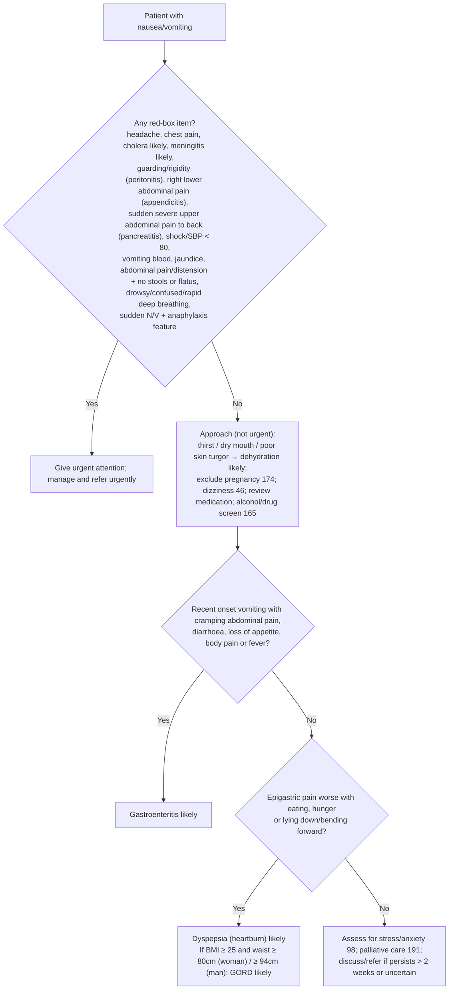

# Page 57 – Nausea/vomiting: flowchart

Source: `inputs/2026/p57.png` (APC 2026). The red box is a list (any one item → urgent); the
lower half of the page ("Approach to the patient with nausea/vomiting not needing urgent
attention") contains a two-question Yes/No algorithm.

## Decision nodes → rules

| Node | Modelled as | Rule |
|---|---|---|
| Red box (pre-check) | Nausea or vomiting triggers the check-for list of every red-box item | `Check for urgent nausea/vomiting conditions` |
| Red box: "X: Y likely" items | Nausea/vomiting **and** the item's findings | `Diagnose probable cholera (nausea/vomiting page)`, `Diagnose probable meningitis (nausea/vomiting page)`, `Diagnose probable peritonitis (nausea/vomiting page)`, `Diagnose probable appendicitis (nausea/vomiting page)`, `Diagnose probable pancreatitis (nausea/vomiting page)` |
| Red box: sudden N/V + anaphylaxis feature → check for anaphylaxis 28 | Sudden-onset nausea or vomiting **and** any listed feature or exposure | `Diagnose possible anaphylaxis (nausea/vomiting page)` (triggers page 28) and a branch of the priority rule |
| Red box = Yes | (nausea or vomiting) **and** (any red-box item) | `Urgent: nausea/vomiting with danger signs` |
| Approach: dehydration likely | Nausea/vomiting **and** (increased thirst or xerostomia or decreased skin turgor) | `Diagnose probable dehydration (nausea/vomiting page)` |
| Q1 = Yes | Vomiting **and** any of abdominal colic, diarrhoea, loss of appetite, generalised aches, fever | `Diagnose probable gastroenteritis (nausea/vomiting page)` |
| Q1 = No → Q2 = Yes | Epigastric pain that is postprandial, or with hunger pain, or with pain aggravated by position. The "Q1 = No" precondition is **not** modelled (as in the gold standard) | `Diagnose probable dyspepsia (nausea/vomiting page)` |
| Q2 = Yes + BMI/waist | Dyspepsia evidence **and** BMI ≥ 25 **and** waist ≥ 94 cm (sex-specific 80 cm threshold not representable) | `Diagnose probable GORD (nausea/vomiting page)`; waist via `Measure BMI and waist circumference for dyspepsia (nausea/vomiting page)` |
| Q2 = No | Referral/management and cross-references only | not modelled |

## Notes

- "Recent onset" (Q1) has no number on the page, so no time comparison is used.
- "Cholera outbreak area in past 5 days" is an exposure to *Vibrio cholerae* with onset within 5 days.
- Shock is encoded only as written on the page: the shock finding or SBP < 80.
