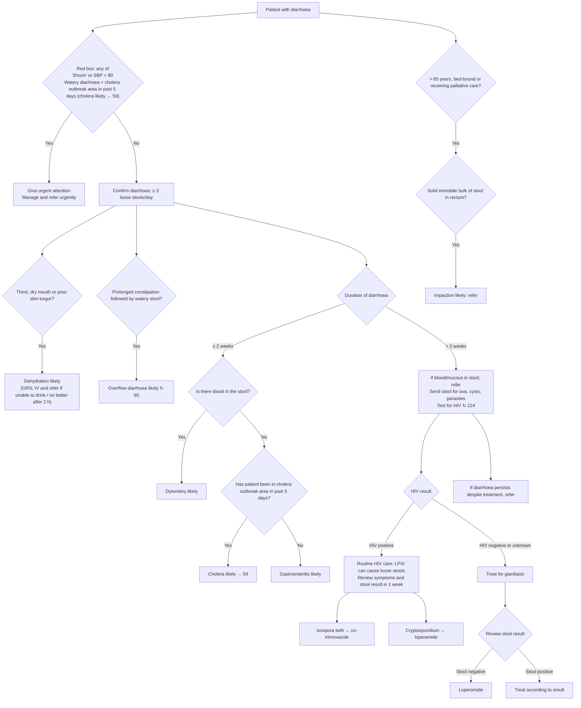

# Page 58 – Diarrhoea: flowchart

Source: `inputs/2026/p58.png` (APC 2026, page 58). Red box first, then the approach for the patient
not needing urgent attention.

¹ Footnote: "If SBP < 80, pulse ≥ 100, respiratory rate > 30, confusion/restlessness, weakness,
shock likely." Not built as a shared shock definition (decision for all pages); the red box is
encoded as written, shock finding or SBP < 80.

## Decision nodes → rules

| Node | Modelled as | Rule |
|---|---|---|
| Presenting complaint | `Diarrhea` (common symptom) | `Check for diarrhoea urgent signs and causes` (trigger) |
| Red box: Shock or SBP < 80 | `(or Shock (< SBP 80))` | `Urgent: diarrhoea with shock or cholera` |
| Red box: watery diarrhoea + cholera outbreak area → cholera likely | Watery-qualified diarrhoea **and** exposure to *Vibrio cholerae* | `Diagnose probable cholera in diarrhoea` (first branch); priority uses `(active_condition Cholera)` |
| Thirst, dry mouth or poor skin turgor | Diarrhoea **and** any of increased thirst, xerostomia, decreased skin turgor | `Diagnose probable dehydration in diarrhoea` |
| Prolonged constipation followed by watery stool | Chronic constipation **and** watery-qualified diarrhoea | `Diagnose probable overflow diarrhoea` |
| Duration ≤ 2 weeks | `(<= (onset Diarrhea) (time_ago 2 weeks))` | used in dysentery, cholera (second branch), gastroenteritis rules |
| Blood in stool = Yes | Hematochezia | `Diagnose probable dysentery in diarrhoea` |
| Blood = No, cholera area = Yes | `(no Hematochezia)` **and** exposure to *Vibrio cholerae* | `Diagnose probable cholera in diarrhoea` (second branch) |
| Blood = No, cholera area = No | `(no Hematochezia)` **and** `(no exposure)` | `Diagnose probable gastroenteritis in diarrhoea` |
| Duration > 2 weeks, HIV negative or unknown → treat for giardiasis | `(>= (onset Diarrhea) (time_ago 2 weeks))` **and** `(no HIV infection)` | `Diagnose possible giardiasis in chronic diarrhoea` |
| HIV positive → Isospora belli / Cryptosporidium | Stool laboratory result: not modelled | — (see remaining questions) |
| > 65 years, bed-bound or palliative care → check rectum | Bed-ridden or seen by palliative care service (age not representable) | `Check rectum for faecal impaction in diarrhoea` (task) |
| Solid immobile bulk of stool in rectum → impaction likely | Fullness of rectum due to feces **and** the gate above | `Diagnose probable faecal impaction in diarrhoea` |

## Notes

- Cholera outbreak "in past 5 days" is not modelled as a time comparison (as on page 20, exposure
  findings are taken to be recent; they do not record an onset).
- "≤ 2 weeks" / "> 2 weeks" both use the 2-week boundary; VHA allows only `>=`/`<=` in onset
  comparisons, so a patient at exactly 2 weeks matches both branches.
- Management (ORS, IV fluids, medicines, referral, advice, stool tests, HIV test) is not modelled.
