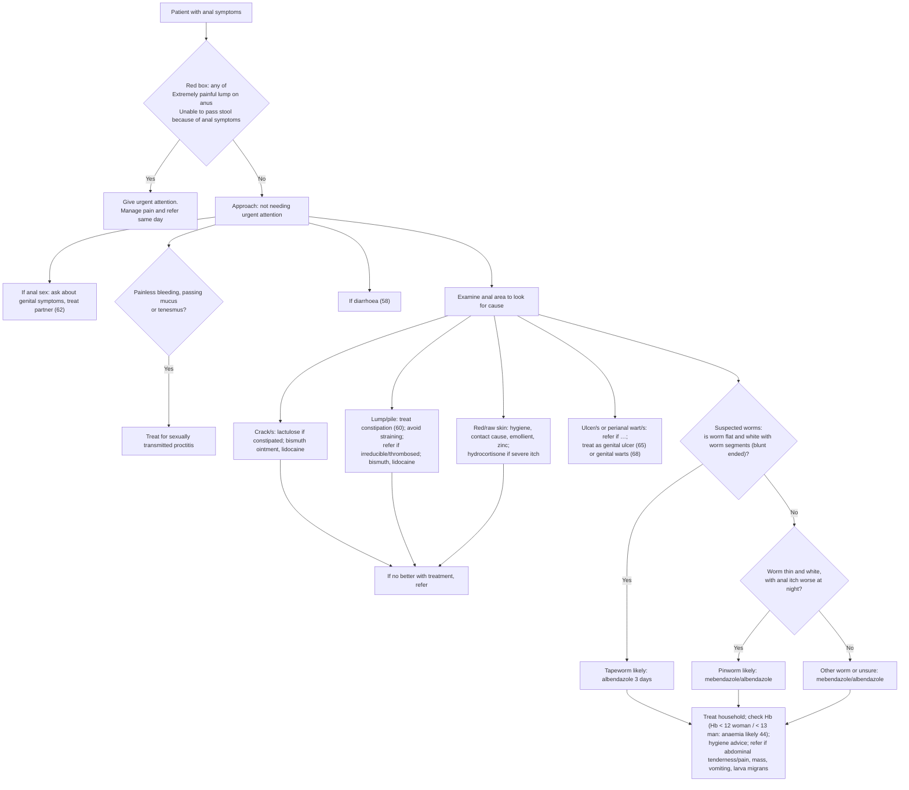

# Page 61 – Anal symptoms: flowchart

Source: APC 2026 e-book page 61 (`inputs/2026/p61.png`). The red box is a screen; below it, the
"Approach to the patient with anal symptoms not needing urgent attention" is a branching
examination algorithm with one Yes/No question (worms).

## Decision nodes → rules

| Node | Modelled as | Rule |
|---|---|---|
| Patient with anal symptoms | `(clinical_finding "Anal finding")` as trigger | `Check for urgent anal symptoms and their causes` |
| Red box = Yes | Anal finding **and** (perianal lump with severe anal pain **or** does not defecate) | `Urgent: anal symptoms with very painful lump or unable to pass stool` |
| Painless bleeding / mucus / tenesmus = Yes | Anal finding **and** any of painless rectal bleeding, mucus in stool, tenesmus | `Diagnose probable sexually transmitted proctitis (anal symptoms)` |
| Suspected worms → No → thin white worm with anal itch worse at night | Worms in stool **and** pruritus ani qualified "Night time" (worm shape not representable) | `Diagnose probable pinworm (anal symptoms)` |
| Suspected worms → Yes (flat, white, segmented) → tapeworm likely | **Not encoded**: no SNOMED finding for a flat/segmented worm; see remaining questions | — |
| Hb < 12 / < 13 → anaemia likely | **Not encoded**: Hb has no unit/observable in the language | — |
| Crack/s, lump/pile, red/raw skin, ulcer/wart branches | Examination routing to management only; no "likely" statement | — (management) |
| Anal sex → genital symptoms, partner; diarrhoea → 58 | Cross-references | — |

## Notes

- "Extremely painful" is read as `Severe (severity modifier)` on `Anal pain`, paired with
  `Perianal lump`; the language cannot tie the pain to the lump.
- "because of anal symptoms" is expressed only by the `and` with the anal-symptom trigger.
- The proctitis branch is not gated on anal sex (the page's sentences are separate); see remaining questions.
