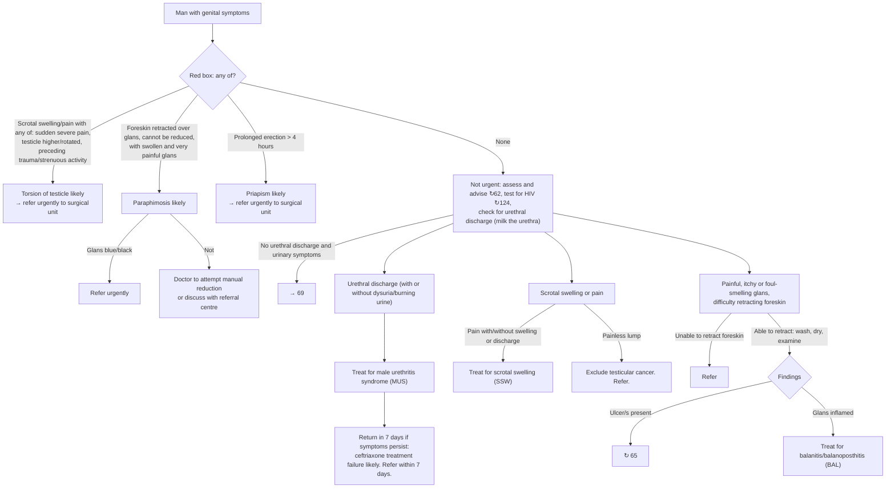

# Page 63 – Genital symptoms in a man: flowchart

Source: APC 2026 e-book page 63 (`inputs/2026/p63.png`): the red box, then the three-column
"Approach to the man with genital symptoms not needing urgent attention".

## Decision nodes → rules

| Node | Modelled as | Rule |
|---|---|---|
| Man with genital symptoms | `(clinical_finding "Male genitalia finding")`; descendants (scrotal swelling/pain, retracted foreskin, prolonged erection, testicular/scrotal mass) match automatically | Trigger of `Check for urgent genital conditions in a man` |
| Torsion of testicle likely | (scrotal swelling **or** scrotal pain) **and** (sudden-onset severe scrotal pain **or** injury of scrotum/testis). "Testicle higher/rotated" and "strenuous activity" have no SNOMED concept (see remaining questions) | `Diagnose probable torsion of testis from genital symptoms` |
| Paraphimosis likely | fixed retracted foreskin **and** swollen glans **and** severe glans pain | `Diagnose probable paraphimosis from genital symptoms` |
| Priapism likely | prolonged erection with onset ≥ 4 hours ago (page: "> 4 hours"; `>=` because the database rejects `>` in onset comparisons) | `Diagnose probable priapism from genital symptoms` |
| Red box → urgent | genital symptoms **and** any of the three likely diagnoses | `Urgent: genital symptoms in a man with torsion, paraphimosis or priapism` |
| Glans blue/black; manual reduction | Management of paraphimosis | Not modelled (management) |
| Urethral discharge → Treat for MUS | urethral discharge → probable `Urethritis` | `Diagnose probable male urethritis syndrome from urethral discharge` |
| Ceftriaxone treatment failure likely | Needs "after MUS treatment, symptoms persist at 7 days" | Not modelled (treatment history is not representable) |
| Pain with/without swelling → Treat for SSW | No SNOMED concept for the SSW syndrome | Not modelled (SNOMED gap) |
| Painless lump → Exclude testicular cancer | painless mass of testicle **or** of scrotum → possible malignant neoplasm of testis | `Diagnose possible testicular cancer from painless scrotal lump` |
| Glans inflamed → Treat for BAL | inflammatory morphology at the glans → probable `Balanitis` (Balanoposthitis is a descendant) | `Diagnose probable balanitis/balanoposthitis from inflamed glans` |
| Ulcers → 65; urinary symptoms → 69; unable to retract → refer | Cross-references and routing | Not modelled |
