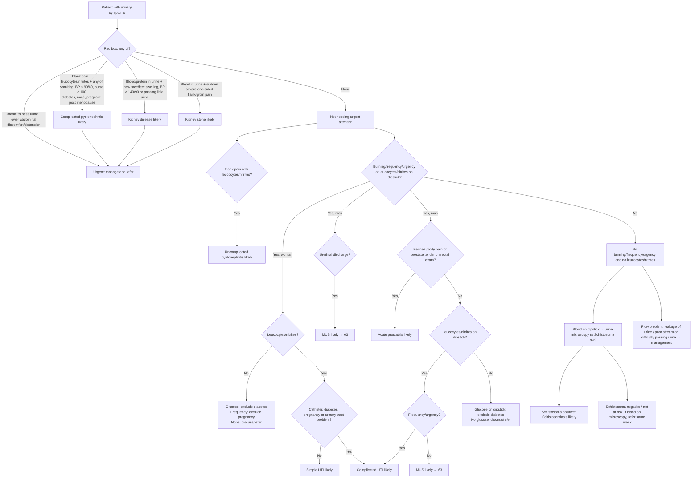

# Page 69 – Urinary symptoms: flowchart

Source: APC 2026 e-book page 69 (`inputs/2026/p69.png`). Red box, then the "Approach to the patient
with urinary symptoms not needing urgent attention" algorithm below it.

## Decision nodes → rules

| Node | Modelled as | Rule |
|---|---|---|
| Presenting complaint | `(clinical_finding Urinary symptoms)` (not a recorded common symptom) | trigger of `Check for urgent urinary symptom conditions` and `Check for urinary infection features` |
| Red box: unable to pass urine | `Unable to void urine` **and** (lower abdominal discomfort **or** lower abdominal distension) | `Urgent: urinary symptoms with retention, complicated pyelonephritis, kidney disease or kidney stone`, first branch |
| Red box: complicated pyelonephritis likely | `Flank pain` **and** (leucocytes **or** nitrites) **and** any of the seven risk items | Priority rule second branch (inline evidence); `Diagnose probable acute pyelonephritis from urinary symptoms` (no SNOMED concept for "complicated") |
| Red box: kidney disease likely | (blood **or** protein in urine) **and** (new face/feet swelling **or** SBP ≥ 140 **or** DBP ≥ 90 **or** oliguria) | `Diagnose probable kidney disease from urinary symptoms`; priority third branch |
| Red box: kidney stone likely | `Blood in urine` **and** sudden severe left/right flank or inguinal pain | `Diagnose probable kidney stone from urinary symptoms`; priority fourth branch |
| Uncomplicated pyelonephritis likely | `Flank pain` **and** (leucocytes **or** nitrites) | `Diagnose probable acute pyelonephritis from urinary symptoms` |
| Woman, leucocytes/nitrites, Q = No | Female **and** (leucocytes **or** nitrites) **and** `(no …)` for catheter, diabetes, pregnancy, urinary tract disorder | `Diagnose probable simple UTI (urinary symptoms page)` |
| Woman Q = Yes; Man, no prostatitis features, leucocytes/nitrites, frequency/urgency | as described | `Diagnose probable complicated UTI (urinary symptoms page)` |
| Man: urethral discharge; or no prostatitis features, leucocytes/nitrites, no frequency/urgency | as described | `Diagnose probable MUS (urethritis) from urinary symptoms` |
| Man: perineal/body pain or tender prostate | Male **and** entry condition **and** any of the three | `Diagnose probable acute prostatitis from urinary symptoms` |
| Woman/Man, no leucocytes/nitrites, glucose: exclude diabetes | Glycosuria, with the branch conditions | `Diagnose possible diabetes from urinary symptoms` |
| Woman, no leucocytes/nitrites, frequency: exclude pregnancy | Female, `(no …)` leucocytes and nitrites, increased frequency | `Diagnose possible pregnancy from urinary symptoms` |
| Schistosoma positive → schistosomiasis likely | Not modelled: no SNOMED finding for "Schistosoma ova in urine" | — (see remaining questions) |
| Flow problem (leakage, poor stream) | Management only, no "likely" diagnosis | — |

## Notes

- BP < 90/60 is read as systolic < 90 **or** diastolic < 60; BP ≥ 140/90 as systolic ≥ 140 **or**
  diastolic ≥ 90.
- "No" branches are encoded with `(no …)`, which needs the health worker to have recorded "No".
