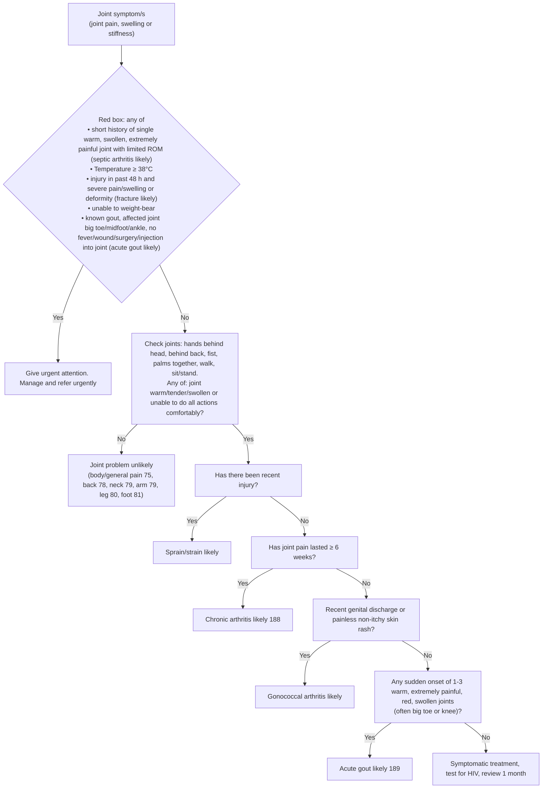

# Page 77 – Joint symptoms: flowchart

Source: `inputs/2026/p77.png` (APC 2026). The red box (urgent) sits above the flowchart
"Approach to the patient with a joint symptom/s not needing urgent attention".

## Decision nodes → rules

| Node | Modelled as | Rule |
|---|---|---|
| Joint symptom/s (entry) | Pain of joint, joint swelling or joint stiffness → possible arthropathy, which triggers the check tasks | `Diagnose possible arthropathy from joint symptoms` → `Check for urgent joint symptom conditions`, `Assess joint symptom not needing urgent attention` |
| Red box: septic arthritis likely | Joint warm **and** joint swelling **and** severe joint pain **and** limitation of joint movement ("short history" and "single" not modelled) | `Diagnose probable septic arthritis (joint symptoms)` |
| Red box: fracture likely | Traumatic injury with onset within 48 hours **and** any of severe joint pain, severe joint swelling, deformity | `Diagnose probable fracture after joint injury` |
| Red box: acute gout likely | Known gout **and** joint pain at big toe / midfoot / ankle **and** no fever **and** no wound (surgery / injection into joint not modelled) | `Diagnose probable acute gout in known gout (joint red box)` |
| Red box as a whole | Joint symptom **and** any of: probable septic arthritis, temperature ≥ 38°C, probable fracture, unable to weight-bear, the known-gout criteria | `Urgent: joint symptoms with red-box sign` |
| A = Yes / No | Any of joint warm, tenderness of joint, joint swelling, limitation of joint movement | used as the first condition of each flowchart diagnosis rule below; "Joint problem unlikely" is routing only |
| Recent injury = Yes | A **and** traumatic injury | `Diagnose probable joint sprain` |
| Injury = No → ≥ 6 weeks = Yes | A **and** no traumatic injury **and** joint pain onset ≥ 6 weeks ago | `Diagnose probable chronic arthritis (joint symptoms)` |
| ≥ 6 weeks = No → discharge/rash = Yes | A **and** no traumatic injury **and** joint pain onset ≤ 6 weeks ago **and** (vaginal or urethral discharge, or painless rash with no itching) | `Diagnose probable gonococcal arthritis` |
| discharge/rash = No → sudden hot joints = Yes | A **and** no traumatic injury **and** joint pain onset ≤ 6 weeks ago **and** no discharge **and** no painless rash **and** sudden-onset severe joint pain, joint warm, joint swelling, red joint | `Diagnose probable acute gout (sudden hot swollen joint)` |
| sudden hot joints = No | Symptomatic management only | not modelled (management) |

## Notes

- "Not needing urgent attention" is not modelled as a negation of the red box: the flowchart rules
  can fire alongside the urgent priority.
- "Recent" (injury, genital discharge) has no threshold on the page and is taken as recorded in the
  current encounter. The red box's "past 48 hours" is a time comparison.
- "< 6 weeks" (the No branch) is written `<=` because only `>=`/`<=` are accepted in onset
  comparisons; exactly 6 weeks falls into both branches.
