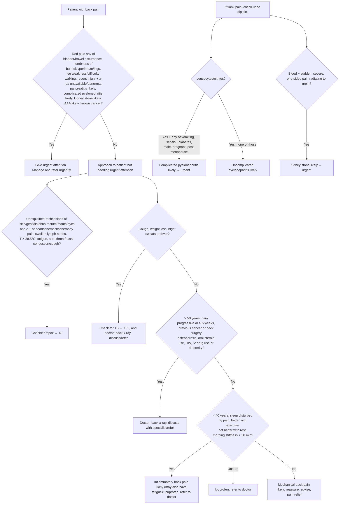

# Page 78 – Back pain: flowchart

Source: APC 2026 e-book, page 78 (`inputs/2026/p78.png`): red box, then "Approach to patient with
back pain not needing urgent attention".

¹ Sepsis is any of: SBP < 80, pulse ≥ 100, respiratory rate > 30, confusion.

## Decision nodes → rules

| Node | Modelled as | Rule |
|---|---|---|
| Red box (all items) | `(and (or Backache Flank pain) (or …red box items…))` | `Urgent: back pain with red flag signs` |
| Red box items to ask | check_for list | `Check for urgent back pain conditions` |
| If flank pain, check urine dipstick | Task triggered by flank pain, checking leucocytes, nitrites, blood and the complicating factors | `Check urine dipstick and pyelonephritis/kidney stone signs in back pain with flank pain` |
| Leucocytes/nitrites (complicated or uncomplicated) | Flank pain **and** (leucocytes or nitrites) | `Diagnose probable pyelonephritis in back pain with flank pain` |
| Complicated pyelonephritis likely | Flank pain, leucocytes/nitrites **and** any of vomiting, sepsis (SBP < 80, pulse ≥ 100, RR > 30, confusion), diabetes, male, pregnancy, post menopause; written directly into the priority rule because SNOMED has no "complicated pyelonephritis" | `Urgent: back pain with red flag signs` (pyelonephritis branch) |
| Kidney stone likely | Sudden, severe, unilateral flank pain **and** groin pain **and** blood in urine | `Diagnose probable kidney stone in back pain with flank pain` |
| Pancreatitis likely | Backache **and** sudden-onset severe upper abdominal pain **and** (nausea or vomiting) | `Diagnose probable acute pancreatitis in back pain` |
| AAA likely | Backache **and** pulsatile abdominal mass | `Diagnose probable abdominal aortic aneurysm in back pain` |
| Consider mpox | Rash/lesion **and** any of the listed symptoms | `Diagnose possible mpox in back pain with rash or lesions` |
| Q1 = Yes → Check for TB | Backache **and** any of cough, weight decreased, night sweats, fever | `Diagnose possible tuberculosis in back pain with TB symptoms` |
| Q2 = Yes → doctor x-ray | Management only; no diagnosis named | not modelled (routing) |
| Q3 = Yes → Inflammatory back pain likely | Not modelled: no SNOMED concept, and none of the Q3 criteria (age, sleep disturbed by pain, better with exercise, not better with rest, morning stiffness > 30 min) has a SNOMED concept or an age form | see remaining questions |
| Q3 = No → Mechanical back pain likely | Not modelled: it needs "No" to Q3, which cannot be expressed, and "No" to "> 50 years" | see remaining questions |
