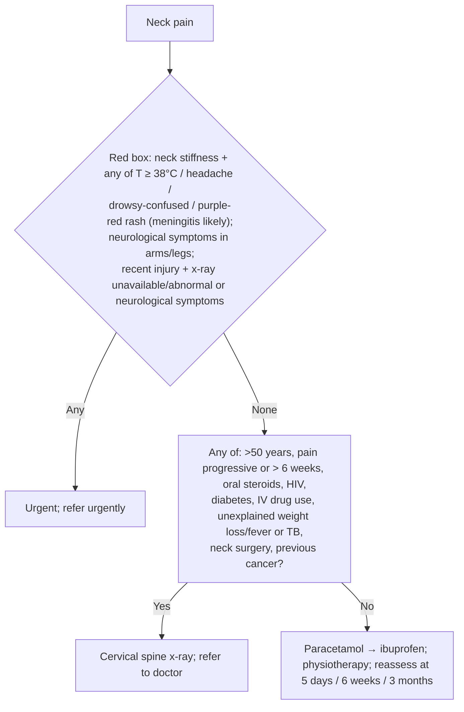
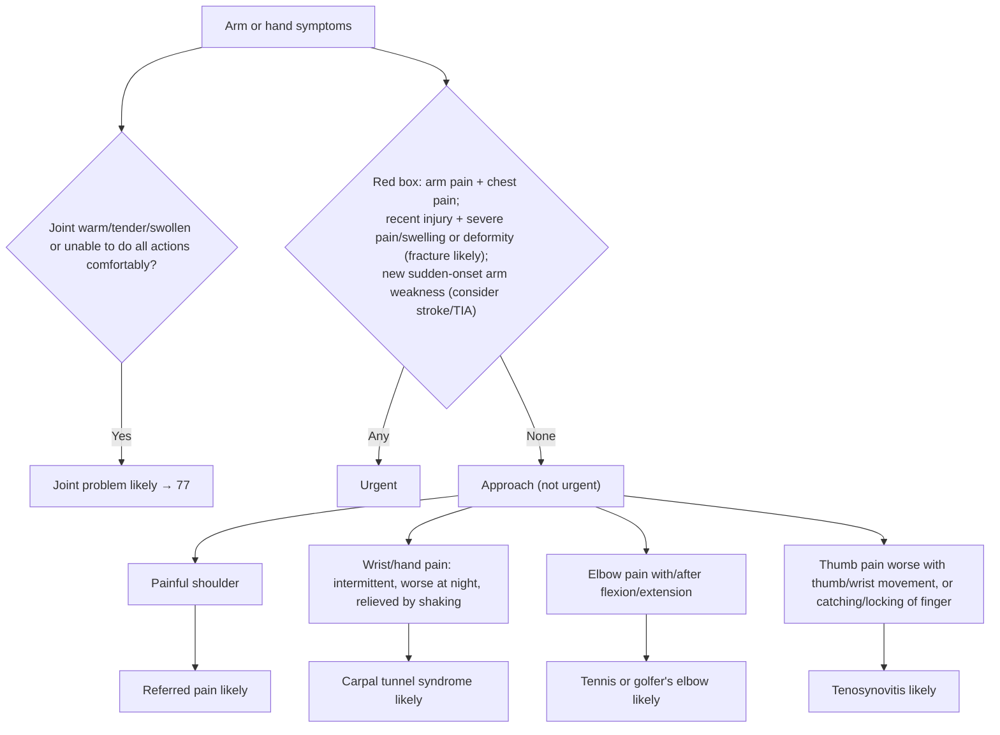

# Page 79 – Neck pain (and arm or hand symptoms): flowchart

Source: `inputs/2026/p79.png`. The page has two sections, each with a red box and an
"approach … not needing urgent attention" part. The neck-pain approach has a Yes/No branch; the
arm/hand approach is a set of parallel presentation → "X likely" columns.

## Neck pain

| Node | Modelled as | Rule |
|---|---|---|
| Neck pain (complaint) | `(clinical_finding Neck pain)` | `Check for urgent neck pain conditions` (trigger) |
| Meningitis likely | Stiff neck **and** any of temperature ≥ 38 °C, headache, drowsy, acute confusion, purpuric rash, erythematous rash | `Diagnose probable meningitis from neck pain page` |
| Red box (any item) | Neck pain **and** any of: probable meningitis; any neurological limb symptom; recent neck injury with a neurological symptom | `Urgent: neck pain with meningitis, neurological symptoms or neck injury` |
| Recent injury + x-ray unavailable/abnormal | Not representable (no x-ray finding); only the "or neurological symptoms" half is encoded | same priority rule, injury branch |
| Q (risk factors) → Yes/No | Not modelled: both branches are management (x-ray, referral, analgesia). No diagnosis is named | — |

## Arm or hand symptoms

| Node | Modelled as | Rule |
|---|---|---|
| Arm or hand symptoms (complaint) | `or` of pain in upper limb (covers hand, wrist, elbow, shoulder, thumb pain as descendants), muscle weakness of upper limb, numbness of upper limb, swelling of upper limb | `Check for urgent arm or hand conditions`, `Check for causes of arm or hand symptoms` (trigger) |
| Arm pain with chest pain | Pain in upper limb **and** chest pain | `Urgent: arm or hand symptoms with chest pain, fracture or sudden weakness` |
| Fracture likely | Recent upper-limb injury **and** (severe arm pain, severe arm swelling or upper-limb deformity) | `Diagnose probable fracture of upper limb from arm or hand symptoms` |
| Consider stroke or TIA | Sudden-onset muscle weakness of upper limb | `Diagnose possible stroke from sudden arm weakness`, `Diagnose possible TIA from sudden arm weakness` |
| Red box (any item) | Complaint **and** any of the three above | `Urgent: arm or hand symptoms with chest pain, fracture or sudden weakness` |
| Joint problem likely | Joint warm, tenderness of joint, joint swelling, or limitation of joint movement | `Diagnose probable joint problem from arm or hand symptoms` |
| Referred pain likely | Pain of shoulder region | `Diagnose probable referred pain from painful shoulder` |
| Carpal tunnel syndrome likely | Wrist or hand pain, qualified intermittent **and** night time | `Diagnose probable carpal tunnel syndrome from wrist or hand pain` |
| Tennis or golfer's elbow likely | Pain provoked by movement at the elbow region | `Diagnose probable elbow tendinopathy from elbow pain on movement` |
| Tenosynovitis likely | Thumb pain with pain on thumb or wrist movement, or locking of a finger joint | `Diagnose probable tenosynovitis from thumb pain or finger locking` |
| "If no better after 6 weeks or worsens, refer" | Management, not modelled | — |
