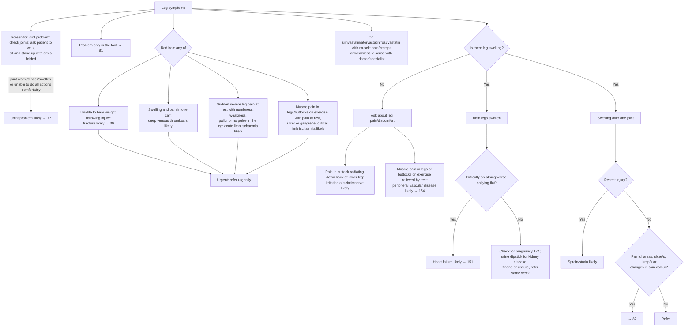

# Page 80 – Leg symptoms: flowchart

Source: `inputs/2026/p80.png` (APC 2026, page 80). Screening bullets, red box, then the approach
to the patient not needing urgent attention.

## Decision nodes → rules

| Node | Modelled as | Rule |
|---|---|---|
| Leg symptoms (presenting complaint) | `Finding of lower limb` (descendants match: leg pain, leg/calf swelling, leg numbness/weakness) | due_to of both `check_for` tasks; first term of the priority rule |
| Red box, fracture | Unable to weight-bear **and** injury of lower limb | `Diagnose probable fracture of leg (leg symptoms)` |
| Red box, DVT | Unilateral calf swelling **and** calf pain. Risk factors ("especially if …") not required | `Diagnose probable DVT (leg symptoms)` |
| Red box, acute limb ischaemia | Sudden, severe leg pain at rest **and** any of leg numbness, leg weakness, pallor of leg skin, absent pulse in leg | `Diagnose probable acute limb ischaemia (leg symptoms)` |
| Red box, critical limb ischaemia | Intermittent claudication **and** any of leg pain at rest, leg ulcer, gangrene of leg | `Diagnose probable critical limb ischaemia (leg symptoms)` |
| Red box → Urgent | Complaint **and** any of the four diagnoses above | `Urgent: leg symptoms with fracture, DVT or limb ischaemia` |
| Joint screen | Any of joint warm, joint tender, joint swelling, difficulty walking, difficulty standing up | `Diagnose probable joint problem (leg symptoms)` |
| Q1 = No → buttock pain radiating down leg | No leg swelling **and** buttock pain **and** pain radiating to left/right leg | `Diagnose probable sciatic nerve irritation (leg symptoms)` |
| Q1 = No → exercise pain relieved by rest | No leg swelling **and** intermittent claudication | `Diagnose probable peripheral vascular disease (leg symptoms)` |
| Q1 = Yes → both legs → Q2 = Yes | Bilateral leg swelling **and** orthopnoea | `Diagnose probable heart failure (leg symptoms)` |
| Q1 = Yes → one joint → Q3 = Yes | Joint swelling **and** injury of lower limb | `Diagnose probable sprain (leg symptoms)` |
| Q2 = No, Q3 = No → Q4, foot only, statin | Routing and management (check pregnancy, dipstick, refer, → 82, → 81, discuss) | Not modelled (see provenance) |
