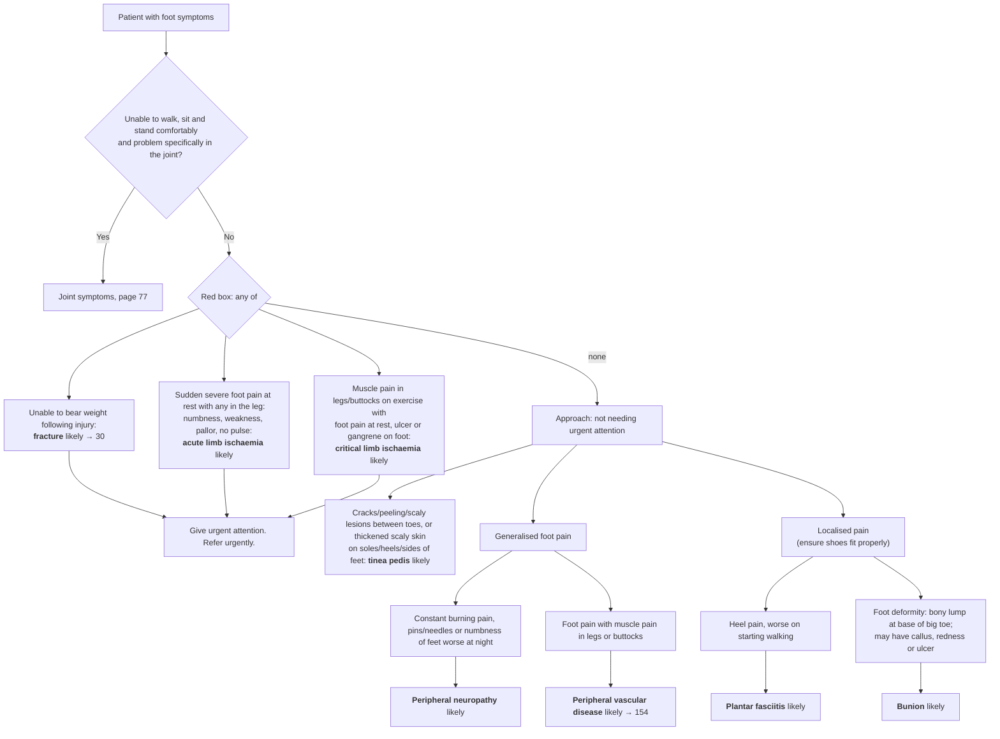

# Page 81 – Foot symptoms: flowchart

Source: `inputs/2026/p81.png` (red box, then "Approach to the patient with foot symptoms not
needing urgent attention").

## Decision nodes → rules

| Node | Modelled as | Rule |
|---|---|---|
| Patient with foot symptoms | `(clinical_finding "Finding of foot region")` (descendants match: foot pain, numbness of foot, ulcer of foot, …) | trigger of `Check for urgent foot symptom conditions`; first `and` arm of `Urgent: foot symptoms with fracture or limb ischaemia` |
| Joint check → 77 | Not modelled (routing to another page; the walk/sit/stand test has no finding of its own) | — |
| Fracture likely | Unable to weight-bear **and** traumatic injury | `Diagnose probable fracture from foot symptoms` |
| Acute limb ischaemia likely | Foot pain with Sudden onset + Severe + At rest qualifiers **and** any of numbness of lower limb, weakness of lower limb muscle, white discoloration of lower limb skin, peripheral pulse absent | `Diagnose probable acute lower limb ischaemia from foot symptoms` |
| Critical limb ischaemia likely | Intermittent claudication **and** any of foot pain at rest, ulcer of foot, gangrene of foot | `Diagnose probable critical lower limb ischaemia from foot symptoms` |
| Give urgent attention | Foot symptom **and** any of the three red-box diagnoses (`active_condition`) | `Urgent: foot symptoms with fracture or limb ischaemia` |
| Tinea pedis likely | Fissure / peeling / scaly skin at the interdigital space of the foot, **or** thick **and** scaly skin at the same site (sole, heel, border of foot) | `Diagnose probable tinea pedis from foot symptoms` |
| Peripheral neuropathy likely | Foot pain **and** any of burning feet, paresthesia of foot, numbness of foot | `Diagnose probable peripheral neuropathy from foot symptoms` |
| Peripheral vascular disease likely | Foot pain **and** any of muscle pain at lower limb, muscle pain at buttock, intermittent claudication | `Diagnose probable peripheral vascular disease from foot symptoms` |
| Plantar fasciitis likely | Heel pain **and** pain aggravated by walking | `Diagnose probable plantar fasciitis from foot symptoms` |
| Bunion likely | Foot pain **and** deformity of foot **and** lump (mass of body region) at the first metatarsophalangeal joint | `Diagnose probable bunion from foot symptoms` |

## Notes

- "Generalised" vs "localised" foot pain is routing; it is not modelled as a qualifier. The
  findings under each branch carry the distinction.
- "Constant" and "worse at night" (neuropathy) and "on starting" walking (plantar fasciitis) are not
  modelled; see the remaining-questions file.
- The diabetes/PVD "foot at risk" box and the daily foot-care advice are review/management content
  and are not modelled.
