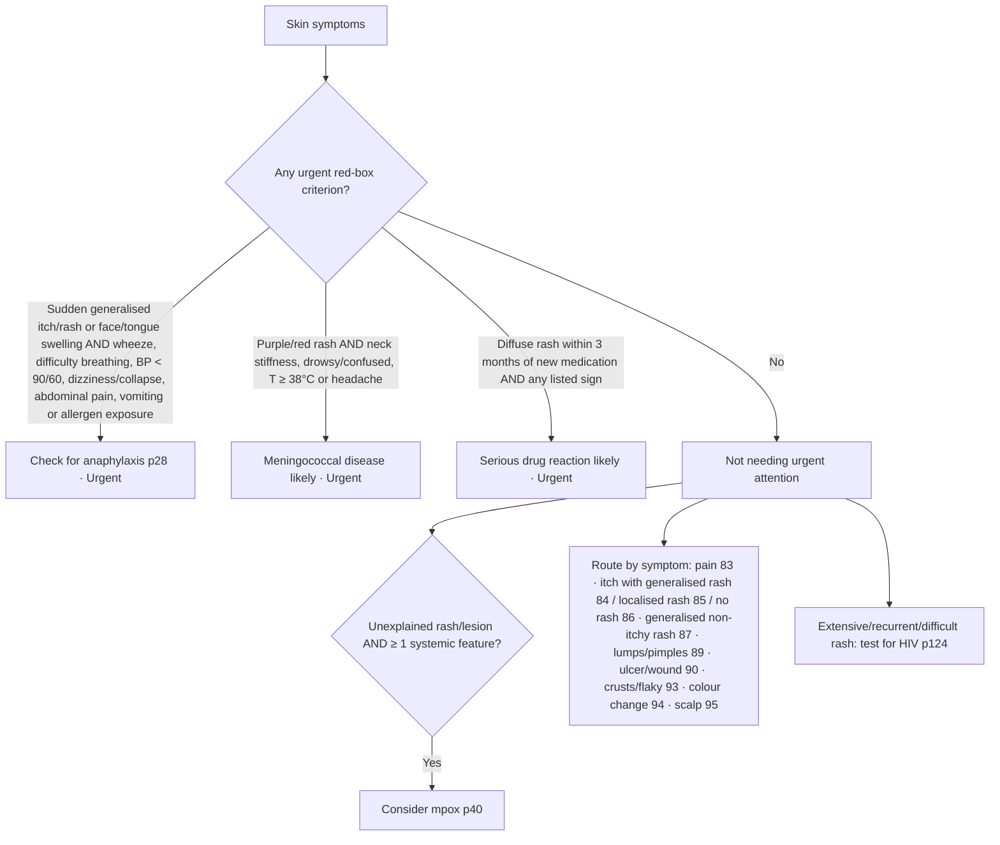

# Page 82 – Skin symptoms: flowchart

The red box is a list of urgent criteria. Below it, the page has a routing chart that sends
non-urgent patients to other pages by symptom. The routing is navigation only, so no rule encodes it.

| Decision node | Rule in `82-skin-symptoms.lisp` |
|---|---|
| Anaphylaxis criteria | "Diagnose possible anaphylaxis from skin symptoms"; first branch of "Urgent: skin symptoms with anaphylaxis signs, meningococcal disease or serious drug reaction" |
| Meningococcal disease likely | "Diagnose probable meningococcal disease from purple/red rash" → Urgent rule |
| Serious drug reaction likely | "Diagnose probable serious drug reaction with diffuse rash" → Urgent rule |
| Consider mpox | "Diagnose possible mpox from skin symptoms" (findings gathered by "Check for mpox features with skin symptoms") |
| Red-box findings | "Check for urgent skin symptom conditions" |
| Symptom routing, HIV test | Not encoded (navigation / management) |
