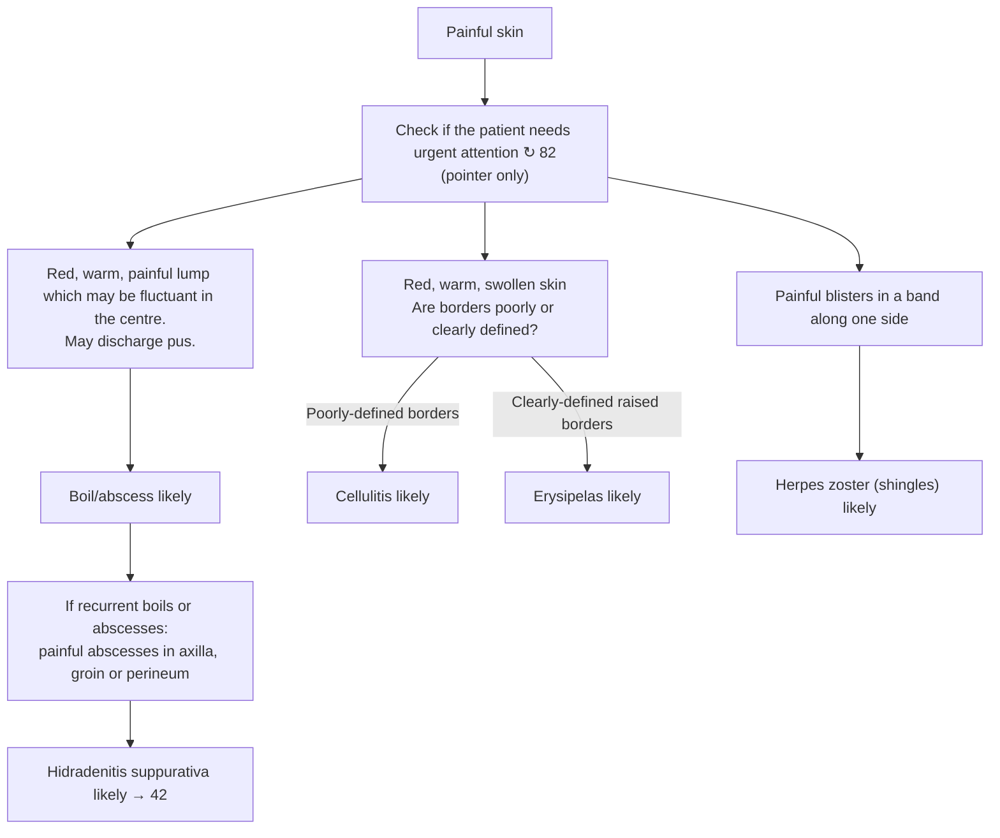

# Page 83 – Painful skin: flowchart

Source: APC 2026 e-book, page 83 (`inputs/2026/p83.png`). The red box is a pointer only
("Check if the patient needs urgent attention ↻ 82"); the page's own logic is three presentation
columns, one of which branches on the borders of the redness.

## Decision nodes → rules

| Node | Modelled as | Rule |
|---|---|---|
| Presenting complaint | `Pain` with `finding_site` `Skin structure` | `Check for painful skin conditions` (trigger) |
| Urgent attention ↻ 82 | Not modelled here (pointer to page 82) | none |
| A → Boil/abscess likely | painful skin **and** `Mass of skin` **and** `Erythema` **and** `Warm skin` | `Diagnose probable boil/abscess of painful skin` |
| Recurrent boils, axilla/groin/perineum → HS likely | painful skin **and** `Recurrent abscess of skin` **and** (`Abscess of axilla` or `Abscess of groin` or `Abscess of perineum`) | `Diagnose probable hidradenitis suppurativa from recurrent painful abscesses` |
| B, poorly-defined borders → Cellulitis likely | painful skin **and** `Erythema` **and** `Warm skin` **and** `Swelling of skin` **and** `Erythema` + `Poorly defined` | `Diagnose probable cellulitis of painful skin` |
| B, clearly-defined raised borders → Erysipelas likely | as above, with `Erythema` + `Well defined` + `Raised` | `Diagnose probable erysipelas of painful skin` |
| C → Herpes zoster likely | painful skin **and** `Blister of skin` + `Zosteriform` + `Unilateral` | `Diagnose probable herpes zoster from painful blisters in a band` |

## Notes

- "May be fluctuant" and "may discharge pus" are optional descriptors on the page, so they are not
  required for the boil/abscess rule and are not checked for.
- All treatment, antibiotic criteria, aciclovir criteria and "Refer same day if" lists are
  management steps and are not modelled.
