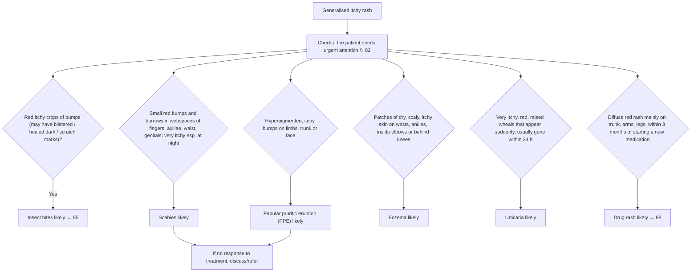

# Page 84 – Generalised itchy rash: flowchart

Source: `inputs/2026/p84.png`. The red box is a pointer only ("Check if the patient needs urgent
attention ↻ 82"). The page is a pattern-recognition grid: a top line (insect bites) and five
picture boxes, each leading to an "X likely" management box.

## Decision nodes → rules

| Node | Modelled as | Rule |
|---|---|---|
| Generalised itchy rash | `Pruritic rash` (disorder) as trigger | `Check for causes of generalised itchy rash` |
| Check urgent attention ↻ 82 | Pointer only; not modelled here | — |
| Insect bites | Pruritic rash + Papule of skin | `Diagnose probable insect bites (generalised itchy rash)` |
| Scabies | Pruritic rash + Burrows in skin + papule at finger web / axilla / waist / genitals | `Diagnose probable scabies (generalised itchy rash)` |
| PPE | Pruritic rash + Hyperpigmentation of skin + papule at limb / trunk / face | `Diagnose probable papular pruritic eruption (generalised itchy rash)` |
| Eczema | Pruritic rash + Xeroderma + scaly skin at wrist / ankle / antecubital / popliteal | `Diagnose probable eczema (generalised itchy rash)` |
| Urticaria | Pruritic rash + Wheal (Sudden onset) | `Diagnose probable urticaria (generalised itchy rash)` |
| Drug rash | Pruritic rash + Erythematous rash (Diffuse) + New medication commenced within 3 months | `Diagnose probable drug rash (generalised itchy rash)` |
| No response → discuss/refer | Management; not modelled | — |
