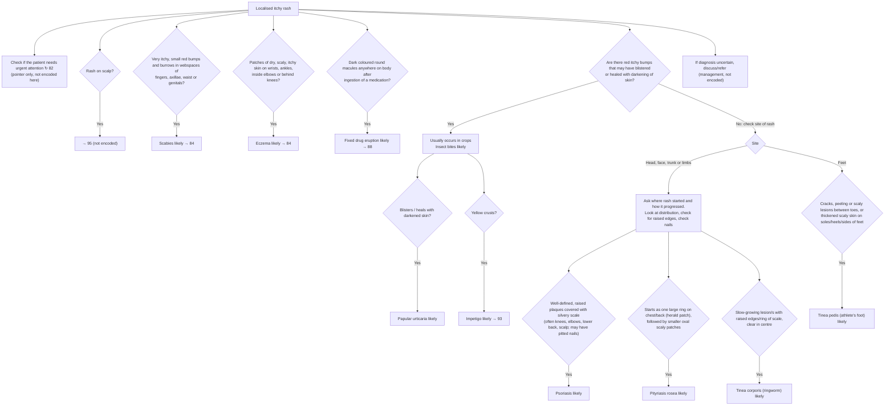

# Page 85 – Localised itchy rash: flowchart

Source: `inputs/2026/p85.png` (APC 2026, page 85). The red box is a pointer only ("Check if the
patient needs urgent attention ↻ 82"); the page's own logic is the bullet list and the flowchart
below it.

## Decision nodes → rules

All findings below are in the `check_for` of `Check for localised itchy rash conditions`, which is
triggered by `Pruritic rash`.

| Node | Modelled as | Rule |
|---|---|---|
| Red box | Pointer to page 82 only | none (cross-reference) |
| Rash on scalp → 95 | Routing to another page | none (flowchart routing) |
| Scabies likely | Severe itching **and** red papules **and** a burrow in the finger webspaces, axilla, waist or genitals | `Diagnose probable scabies (localised itchy rash)` |
| Eczema likely | Itchy rash (trigger) **and** dry scaly skin on the wrist, ankle, antecubital region or popliteal fossa | `Diagnose probable eczema (localised itchy rash)` |
| Fixed drug eruption likely | Dark, round macules **and** exposure to a drug or medicament | `Diagnose probable fixed drug eruption (localised itchy rash)` |
| Q = Yes → Insect bites likely | Itchy rash (trigger) **and** red papules ("red itchy bumps") | `Diagnose probable insect bites (localised itchy rash)` |
| Blisters / heals with darkened skin → Papular urticaria likely | Insect-bite evidence **and** (blister of skin **or** hyperpigmentation of skin) | `Diagnose probable papular urticaria (localised itchy rash)` |
| Yellow crusts → Impetigo likely | Insect-bite evidence **and** yellow crust on skin | `Diagnose probable impetigo (localised itchy rash)` |
| Q = No → site | Not modelled as a gate; the site is carried by each description's own findings | — |
| Psoriasis likely | Well-defined raised skin plaque **and** silver-coloured scaly skin | `Diagnose probable psoriasis (localised itchy rash)` |
| Pityriasis rosea likely | Large annular lesion on the anterior chest or back (herald patch) **and** multiple small scaly patches | `Diagnose probable pityriasis rosea (localised itchy rash)` |
| Tinea corporis likely | Raised annular skin lesion **or** annular scaly skin | `Diagnose probable tinea corporis (localised itchy rash)` |
| Feet → Tinea pedis likely | Fissure, peeling or scaly skin in the toe webs, **or** thickened scaly skin on the sole, heel or border of the foot | `Diagnose probable tinea pedis (localised itchy rash)` |

## Notes

- The "No" branch of the question is not encoded as a negation (for example `(no red papules)`)
  in the psoriasis, pityriasis rosea and tinea rules, following the gold standard, where the Q4
  branch does not require `(no exposure)`.
- Words such as "often", "may have", "typically" and "usually" describe features that are not
  required, so they are not encoded as criteria (psoriasis sites, pitted nails, the Christmas tree
  pattern, "within 2 weeks", "usually occurs in crops", the red-edged itchy patches of fixed drug
  eruption).
- Management boxes (advice, medicines, HIV/diabetes tests, referral, → 93, → 97) are not encoded.
