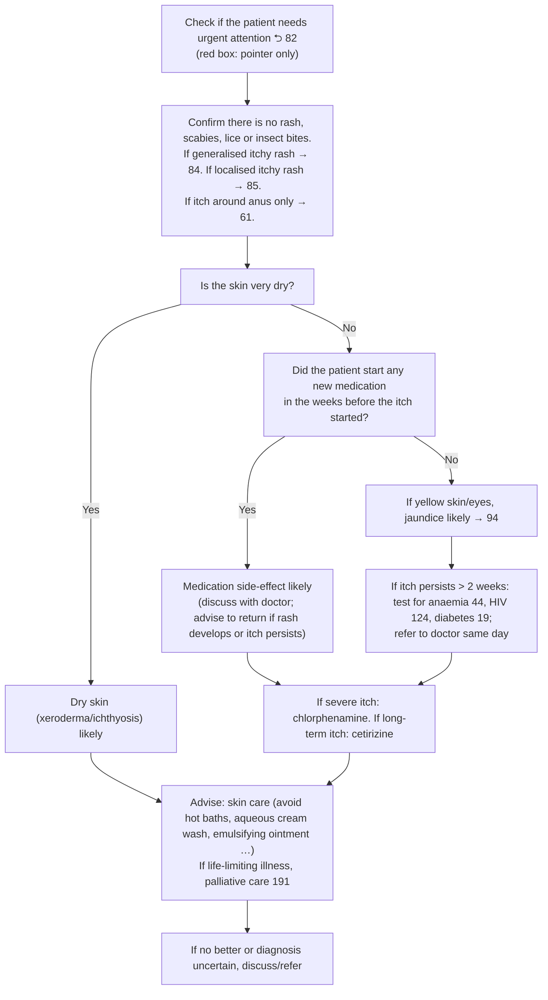

# Page 86 – Itch with no rash: flowchart

Source: `inputs/2026/p86.png`. The red box is a pointer only ("Check if the patient needs urgent
attention 82"); the page's own logic is the flowchart below it.

## Decision nodes → rules

| Node | Modelled as | Rule |
|---|---|---|
| Presenting complaint | `(clinical_finding Itching)` | `Check for causes of itch with no rash` (trigger) |
| "Confirm there is no rash, scabies, lice or insect bites" | Checked for; every diagnosis rule requires `(no …)` of rash (Eruption), scabies, lice and insect bite | All three diagnosis rules |
| Rash → 84 / 85; itch around anus only → 61 | Routing to other pages; not encoded | – |
| Q1 Yes: skin very dry | `Severe dry skin` (child of Xeroderma) | `Diagnose probable dry skin causing itch with no rash` |
| Q1 No → Q2 Yes: new medication in the weeks before itch | `(no Severe dry skin)` and `New medication commenced` | `Diagnose probable medication side-effect causing itch with no rash` |
| Q1 No → Q2 No → yellow skin/eyes | `(no Severe dry skin)`, `(no New medication commenced)`, and Yellow skin or Scleral icterus | `Diagnose probable jaundice in itch with no rash` |
| Itch persists > 2 weeks → tests, refer | Management (tests, referral); not encoded | – |
| Antihistamines, advice, palliative care, discuss/refer | Management; not encoded | – |

## Notes

- "In the weeks before the itch started" cannot be expressed: the language compares an onset with
  `time_ago`, not with another finding's onset. The rule uses the bare finding.
