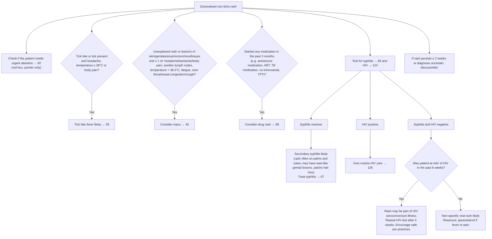

# Page 87 – Generalised non-itchy rash: flowchart

Source: `inputs/2026/p87.png` (APC 2026). The red box only points to page 82 ("Check if the
patient needs urgent attention"); the logic below is the page's own, outside the red box.

¹ HIV can be transmitted via exposure to infectious body fluids, through sexual contact, occupational
or non-occupational exposure, sharing needles, contact with used condom and exposure to blood.

## Decision nodes → rules

| Node | Modelled as | Rule |
|---|---|---|
| Presenting complaint | `Generalized rash` (disorder). "Non-itchy" is not part of the trigger | `Check for generalised non-itchy rash conditions` (task) |
| Red box (→ 82) | Pointer only; not encoded on this page | none (cross-reference) |
| Tick bite + headache / T ≥ 38 / body pain | `and` rash, tick bite, `or` of headache, temperature ≥ 38 °C, generalised aches and pains | `Diagnose probable tick bite fever (generalised non-itchy rash)` |
| Rash or lesion + ≥ 1 systemic feature | `and` of an `or` of rash/lesion sites and an `or` of the systemic features (temperature > 38.5 °C) | `Diagnose possible mpox (generalised non-itchy rash)` |
| Medication started in past 3 months | rash **and** onset of "New medication commenced" within 3 months (`<=`) | `Diagnose possible drug rash (generalised non-itchy rash)` |
| Syphilis reactive | rash **and** `Syphilis titer detected` | `Diagnose probable secondary syphilis (generalised non-itchy rash)` |
| HIV positive | Management only (routine HIV care) | none |
| Syphilis and HIV negative → risk = Yes | rash, syphilis not detected, HIV not detected, exposure to HIV with onset within 6 weeks (`<=`) | `Diagnose possible HIV seroconversion illness (generalised non-itchy rash)` |
| Syphilis and HIV negative → risk = No | rash, syphilis not detected, HIV not detected, **and** (no exposure to HIV **or** exposure onset at least 6 weeks ago) | `Diagnose probable non-specific viral rash (generalised non-itchy rash)` |
| Rash ≥ 2 weeks / uncertain → discuss/refer | Referral step, not encoded | none |

## Notes

- The four top bullets are independent checks; they are not mutually exclusive with the test
  branches, so each is its own rule.
- The "patient may have temperature ≥ 38 °C, headache, lymphadenopathy, muscle pain/body aches"
  line under non-specific viral rash is descriptive, not a criterion; it is not encoded.
