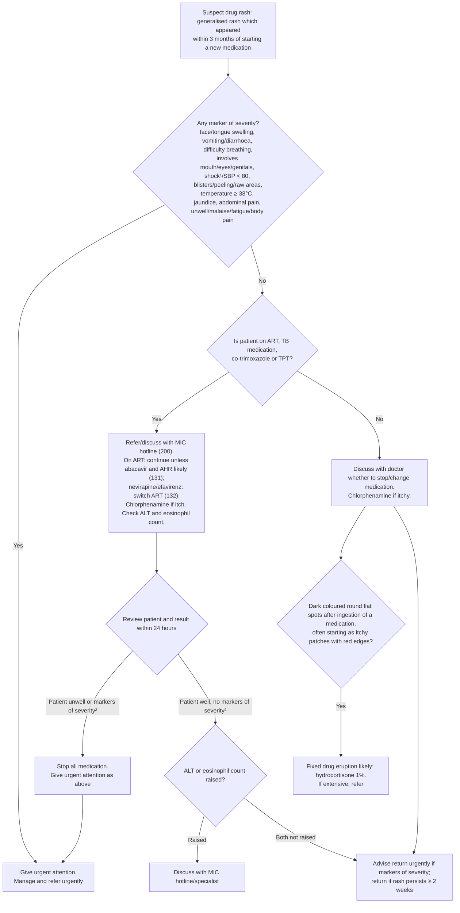

# Page 88 – Drug rash: flowchart

Source: APC 2026 e-book page 88 (`inputs/2026/p88.png`): the red box, the "Approach to the patient
with a drug rash not needing urgent attention" algorithm below it, and the second red box at its
bottom left.

¹ If SBP < 80, pulse ≥ 100, respiratory rate > 30, confusion/restlessness, weakness, shock likely.
² Markers of severity: face/tongue swelling, difficulty breathing, BP < 90/60, temperature ≥ 38°C,
abdominal pain, vomiting/diarrhoea, involves mouth/eyes/genitals, blisters/peeling/raw areas,
jaundice, unwell/malaise/fatigue/body pain.

## Decision nodes → rules

| Node | Modelled as | Rule |
|---|---|---|
| Suspect drug rash | Generalised rash **and** a new medication commenced within the last 3 months | `Suspect drug rash: generalised rash after new medication` (possible) |
| (what makes us look for markers of severity) | Drug rash recorded, or suspected by the rule above | `Check for drug rash markers of severity` |
| New medication question | Asked whenever a generalised rash is recorded, so the suspect rule can fire | `Check for new medication in generalised rash` |
| Any marker of severity (red box) | Drug rash **and** any red-box item; shock written as Shock **or** SBP < 80 | `Urgent: drug rash with markers of severity` |
| Review: "Patient unwell or markers of severity²" → Box 2 "Give urgent attention as above" | Same urgent rule; footnote 2 adds BP < 90/60 (systolic < 90 or diastolic < 60), which the red box does not list | `Urgent: drug rash with markers of severity` |
| On ART/TB medication/co-trimoxazole/TPT? | Not modelled: the branch only routes management (refer, MIC hotline, switch ART) | — |
| AHR likely (131) | Cross-reference to page 131, not modelled here | — |
| ALT or eosinophil count raised | Not representable (no lab-value unit or observable in the language); routing to MIC hotline is management | — |
| Fixed drug eruption likely | Drug rash **and** hyperpigmentation of skin **and** macule of skin (dark, flat spots). "Round", "anywhere on body" and the "often" itchy/red-edged start are not encoded; the "No" branch condition is not encoded | `Diagnose probable fixed drug eruption` |
| Advise/return/refer/discuss | Management | — |

## Notes

- The "Yes" box text says "markers of severity¹", but footnote 1 is the shock definition; the review
  boxes use footnote 2 (markers of severity). Read as markers of severity (footnote 2).
- Footnote 1 ("shock likely") is not built as a probable shock rule: it would be a shared
  definition of shock, and the page does not say whether all or any of the signs are needed.
