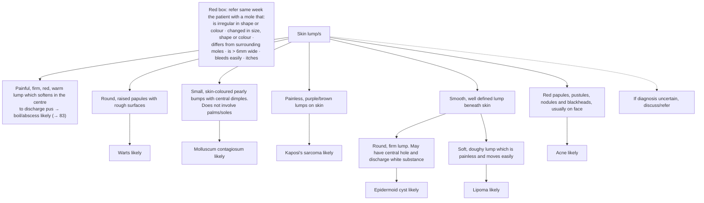

# Page 89 – Skin lump/s: flowchart

Source: `inputs/2026/p89.png`. The page is a decision tree based on what the lesions look like. It has no Yes/No questions, but every branch ends in an "X likely" box.

## Decision nodes → rules

| Node | Modelled as | Rule |
|---|---|---|
| Red box (mole) | Pigmented skin lesion **and** any of: irregular outline, mixed colour, change in skin lesion, changing shape, changing colour, Diameter of lump > 6 mm, bleeding skin, itching of pigmented lesion. "Differs from surrounding moles" has no concept | `Check for mole features needing same-week referral (skin lump/s)`, `Measure width of mole (skin lump/s)`, `Urgent: mole needing same-week referral (skin lump/s)` |
| Boil/abscess | AND of pain of skin, firm skin mass, redness over lesion, warm skin, fluctuant, skin discharge | `Diagnose probable boil/abscess (skin lump/s)` |
| Warts | Round raised papule AND rough skin | `Diagnose probable warts (skin lump/s)` |
| Molluscum | Small papule AND skin dimple (palms/soles exclusion not modelled) | `Diagnose probable molluscum contagiosum (skin lump/s)` |
| Kaposi's sarcoma | Painless skin mass AND (purple OR brown skin mass) | `Diagnose probable Kaposi's sarcoma (skin lump/s)` |
| Epidermoid cyst | Smooth, well-defined subcutaneous mass AND round, firm subcutaneous mass | `Diagnose probable epidermoid cyst (skin lump/s)` |
| Lipoma | Smooth, well-defined subcutaneous mass AND soft, painless subcutaneous mass | `Diagnose probable lipoma (skin lump/s)` |
| Acne | OR of red papule, pustule, skin nodule, comedone | `Diagnose probable acne (skin lump/s)` |
| What triggers the questions | Mass of skin or Mass of subcutaneous tissue | `Check for skin lump/s features` |
| Diagnosis uncertain → discuss/refer | Management | not encoded |
