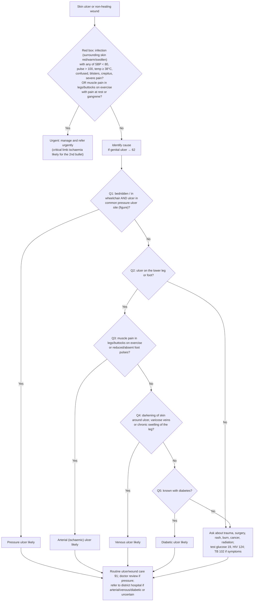

# Page 90 – Skin ulcer or non-healing wound: diagnosis (flowchart)

APC 2026 page 90. Red box first (urgent attention), then the "Identify cause" algorithm.

## Decision nodes

| Node | Page wording | Rule(s) in the `.lisp` |
|---|---|---|
| RB (bullet 1) | "Infection (surrounding skin red/warm/swollen) with any of: systolic BP < 80, pulse > 100, temperature ≥ 38°C, confused, blisters, crepitus or severe pain" | `Urgent: skin ulcer or non-healing wound with infection and systemic or severe signs`; findings in `Check for urgent skin ulcer or non-healing wound conditions` |
| RB (bullet 2) | "Muscle pain in legs or buttocks on exercise associated with pain at rest or gangrene: critical limb ischaemia likely" | `Diagnose probable critical limb ischaemia in a patient with a skin ulcer or non-healing wound` → `Urgent: skin ulcer or non-healing wound with critical limb ischaemia` |
| Q1 | "Is patient bedridden/in wheelchair and is ulcer in common pressure ulcer site (see below)?" | Yes → `Diagnose probable pressure ulcer (APC 2026 page 90)`; No is the first `or` block in each of the three rules below |
| Q2 | "Is ulcer on the lower leg or foot?" | Yes is required by the arterial, venous and diabetic rules; No → no rule (investigation box, not encoded) |
| Q3 | "Does patient have muscle pain in legs/buttocks on exercise or reduced/absent foot pulses?" | Yes → `Diagnose probable arterial (ischaemic) ulcer (APC 2026 page 90)`; No is the `(no …)` triple in the venous and diabetic rules |
| Q4 | "Is there darkening of skin around ulcer, varicose veins or chronic swelling of the leg?" | Yes → `Diagnose probable venous ulcer (APC 2026 page 90)`; No is the `(no …)` triple in the diabetic rule |
| Q5 | "Is patient known with diabetes?" | Yes → `Diagnose probable diabetic ulcer (APC 2026 page 90)`; No → investigation box (not encoded) |
| OTHER / CARE | Investigations, routine care, referral | Not encoded (management / cross-references) |
