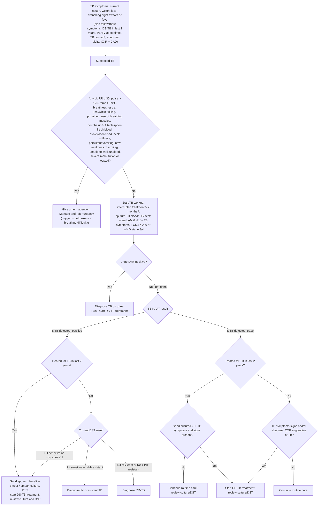

# Page 102 – Tuberculosis (TB): diagnosis: flowchart

Source: `inputs/2026/p102.png` (APC 2026, page 102).

¹ TB contact: shared an enclosed space for ≥ 1 night or frequent/extended daytime periods with an
adult/adolescent with pulmonary TB during the 3 months before the index patient started treatment.

## Decision nodes → rules

| Node | Modelled as | Rule |
|---|---|---|
| TB symptoms / test-without-symptoms (S) | `possible` TB from cough, weight decreased, night sweats, fever, or exposure to *M. tuberculosis complex* (TB contact) | `Diagnose possible TB (TB symptoms or TB contact)` |
| Suspected TB → check the red box | Task triggered by `(diagnosis Tuberculosis possible)` | `Check for urgent TB danger signs` |
| RB = Yes | `(and (diagnosis Tuberculosis possible) (or …red box…))` → Urgent | `Urgent: suspected TB with danger signs` |
| Workup, LAM, TB NAAT, DST, "treated in last 2 years" branches | Not modelled: lab results (LAM, NAAT, DST, CD4, CXR) cannot be expressed; all endpoints are management | none (see remaining-questions) |
| Diagnose TB on urine LAM / INH-resistant TB / RR-TB | Not modelled: evidence is lab results only | none |
