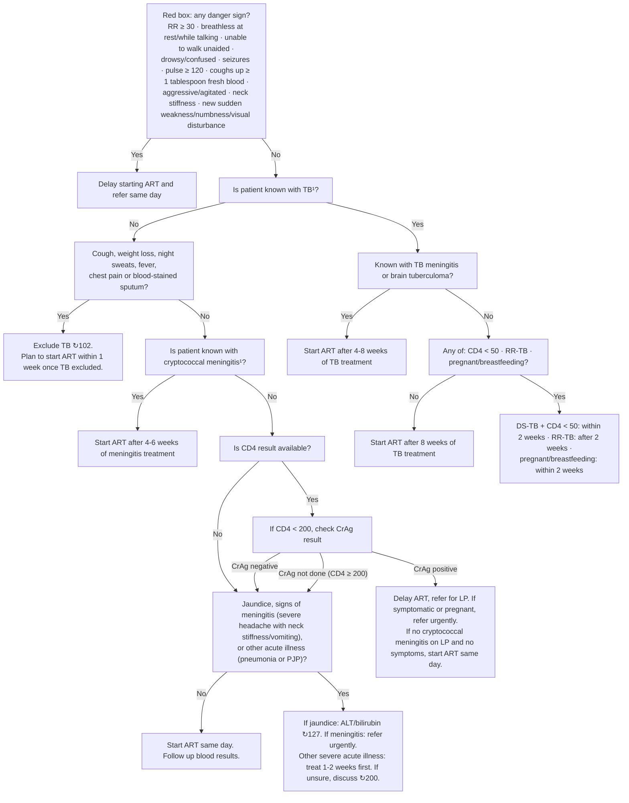

# Page 130 – HIV: Routine care (cont. 5): flowchart

Source: APC 2026 e-book, page 130 (STEP 4. Check if there is a reason to delay ART).

¹ If patient has TB and cryptococcal meningitis, discuss with experienced ART clinician or HIV hotline about when to start ART.

## Decision nodes → rules

| Node | Modelled as | Rule |
|---|---|---|
| Red box | HIV infection **and** any of the ten danger signs (RR ≥ 30 and pulse ≥ 120 as vitals; the rest as findings) | `Check for danger signs before starting ART`, `Urgent: HIV danger signs before starting ART` |
| Q1 (known with TB?) | `(clinical_finding Tuberculosis (qualifier Known present))`, checked for; Q1 = No is `(no …)` | `Check for TB before starting ART`, `Diagnose possible TB before starting ART` |
| Q1 = No → Q2 = Yes → "Exclude TB" | HIV **and** not known TB **and** any of cough, weight decreased, night sweats, fever, chest pain, bloodstained sputum → `possible` TB | `Diagnose possible TB before starting ART` |
| Q3 (known cryptococcal meningitis) | Only leads to ART timing (management) | not encoded |
| Q4 / CrAg branch | CD4 and CrAg are lab results with no representation in the language | not encoded (Could not model) |
| Q5 (jaundice, meningitis signs, acute illness) | Only reached through the CD4/CrAg path; outcomes are management/referral | not encoded (Questions for a clinician) |
| Q6, Q7 (known TB branch) | ART timing only; CD4 < 50 is a lab value | not encoded |
