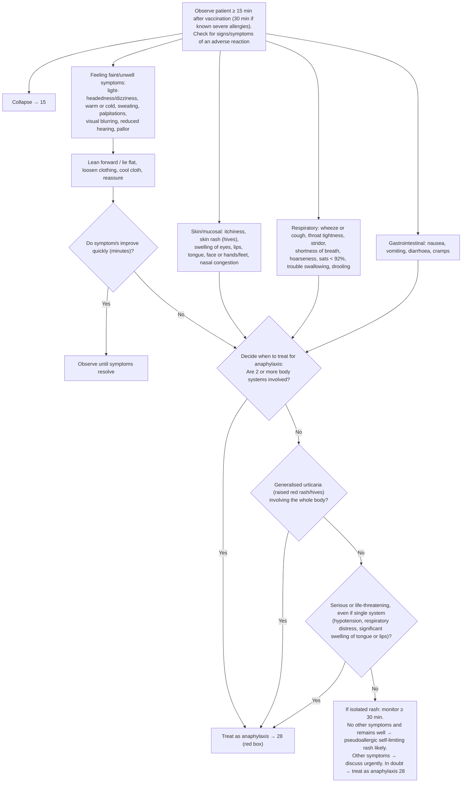

# Page 14 – Observation post vaccination: flowchart

Source: `inputs/2026/p14.png` (APC 2026, page 14). The only red box is the pointer
"Treat as anaphylaxis → 28".

## Decision nodes → rules

| Node | Modelled as | Rule |
|---|---|---|
| Start (post-vaccination observation) | `(procedure Administration of vaccine to produce active immunity)` as the trigger; every listed sign/symptom in the `check_for` | `Check for adverse reaction after vaccination` |
| Collapse → 15 | Not modelled here (cross-reference to page 15) | none |
| Feeling faint → improve quickly? | Not modellable (no way to express "improved within minutes"); the faint group enters the body-system count unconditionally | `Diagnose probable anaphylaxis after vaccination` (any2 group 1) |
| Q1 = Yes (≥ 2 body systems) | Vaccination **and** `any2` of four `or` groups (faint, skin/mucosal, respiratory, GI) | `Diagnose probable anaphylaxis after vaccination`, first branch |
| Q2 = Yes (generalised urticaria) | Vaccination **and** Urticaria with qualifier Generalized | `Diagnose probable anaphylaxis after vaccination`, second branch |
| Q3 = Yes (serious single system) | Vaccination **and** any of Low blood pressure, Respiratory distress, Severe swelling of tongue, Severe swelling of lip | `Diagnose probable anaphylaxis after vaccination`, third branch |
| Treat as anaphylaxis → 28 | Pointer; the probable Anaphylaxis diagnosis is the hand-off to page 28 | (page 28) |
| Q3 = No → isolated rash, no other symptoms → pseudoallergic rash likely | Vaccination **and** urticaria **and** `(no …)` of generalised urticaria and every other listed sign except itching | `Diagnose probable non-allergic rash after vaccination` |
| If other symptoms: discuss / in doubt treat as anaphylaxis | Management / judgment; not modelled | none |

## Notes

- "Observe for at least 15 minutes / 30 minutes" is management (observation time), not a criterion.
- "Monitor for other symptoms for at least 30 minutes" before calling the rash pseudoallergic is not
  modelled as a time comparison: the language cannot express "observed for 30 minutes without new symptoms".
