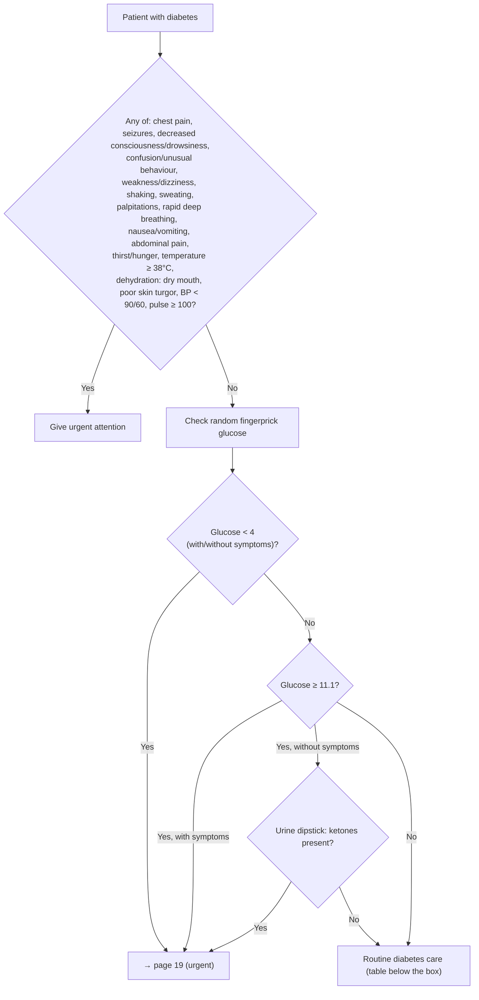

# Page 145 – Diabetes: routine care: flowchart

Source: APC 2026 e-book page 145, red box (`inputs/2026/p145.png`, `p145-box1.png`).

## Decision nodes → rules

| Node | Modelled as | Rule |
|---|---|---|
| Patient with diabetes | `(clinical_finding Diabetes mellitus)` | trigger of `Check for urgent diabetes conditions`, `Measure waist circumference in routine diabetes care` |
| RB = Yes | Diabetes **and** any red-box finding (each `or` split into separate findings; BP < 90/60 = SBP < 90 or DBP < 60) | `Urgent: diabetes with danger signs` |
| G1 = Yes | Diabetes **and** Blood glucose status < 4 mmol/L | `Urgent: diabetes with low or high fingerprick glucose` |
| G2 = Yes, with symptoms | Subsumed: any red-box symptom is already Urgent | `Urgent: diabetes with danger signs` |
| G2 = Yes → ketone check | Glucose ≥ 11.1 triggers the check for Ketonuria | `Check urine dipstick for ketones in diabetes with fingerprick glucose >= 11.1` |
| K = Yes | Diabetes **and** glucose ≥ 11.1 **and** Ketonuria | `Urgent: diabetes with low or high fingerprick glucose` |
| Routine care | Waist circumference measured; the rest of the table is management/routing or lab values | `Measure waist circumference in routine diabetes care` |
