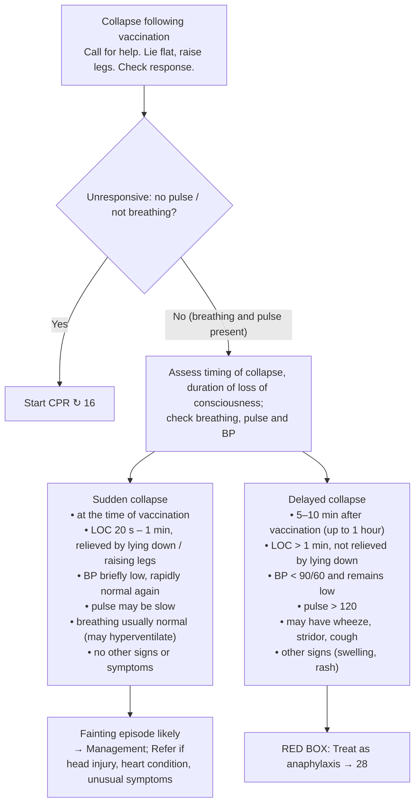

# Page 15 – Collapse following vaccination: flowchart

Source: `inputs/2026/p15.png` (APC 2026 e-book, page 15). Red box: "Treat as **anaphylaxis** → 28" (pointer only).

## Decision nodes → rules

| Node | Modelled as | Rule |
|---|---|---|
| Presenting complaint | Collapse **and** Vaccination given | `Check for features of delayed collapse following vaccination` (trigger) |
| Delayed-collapse signs | check_for wheeze, stridor, cough, swelling, rash (BP and pulse are routine vitals) | `Check for features of delayed collapse following vaccination` |
| Sudden collapse → Fainting episode likely | Collapse, Vaccination given, SBP ≥ 90, DBP ≥ 60, pulse ≤ 120, and none of wheeze, stridor, cough, swelling, rash | `Diagnose probable fainting episode following vaccination` → Syncope (probable) |
| Delayed collapse → Treat as anaphylaxis | Not encoded (pointer to page 28) | — (cross_reference_only) |
| No pulse / not breathing → CPR | Not encoded (management; cardiac arrest is already a warning sign) | — |

## Notes

- Timing (at vaccination vs 5–10 minutes after) and LOC duration cannot be expressed: the language compares an onset only with "time ago", not with another event.
- "Pulse may be slow" and "may hyperventilate" are not required by the rule (the page says "may").
- Management and "Refer if" items are management steps and are not encoded.
